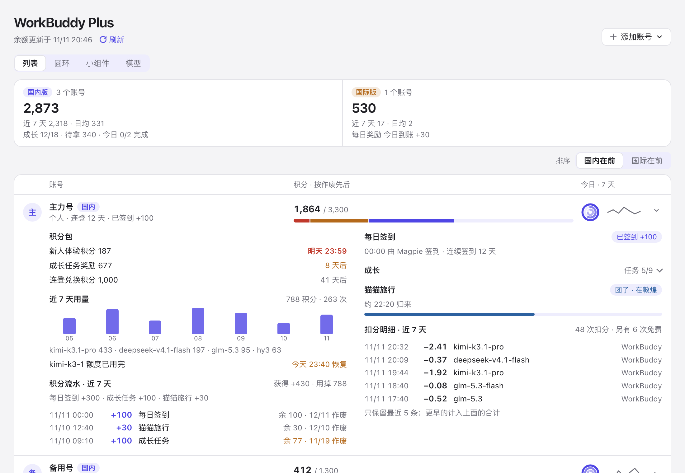
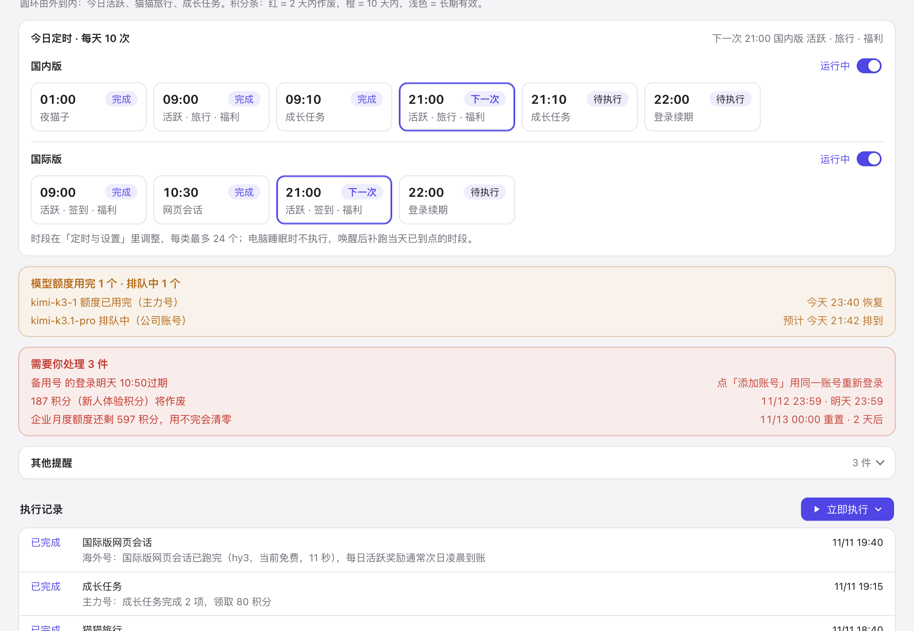
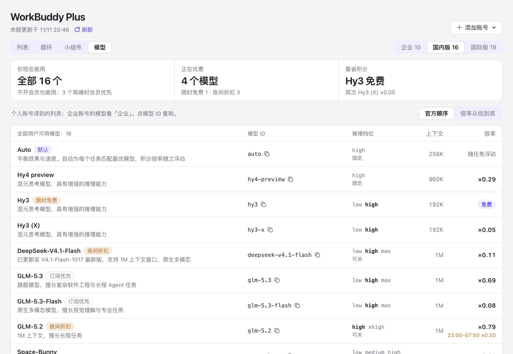
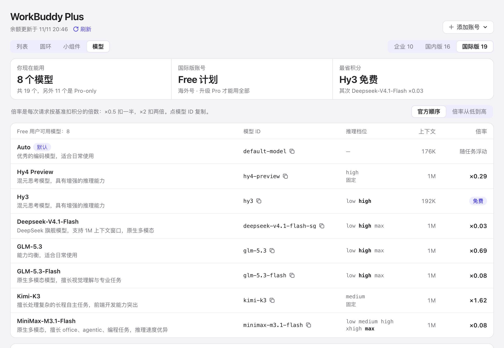
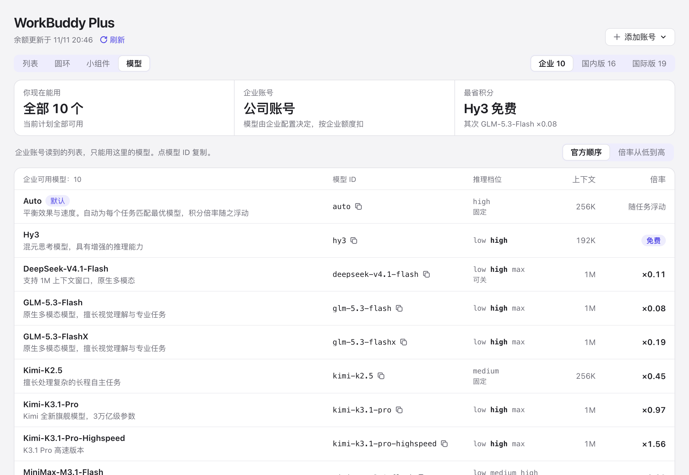
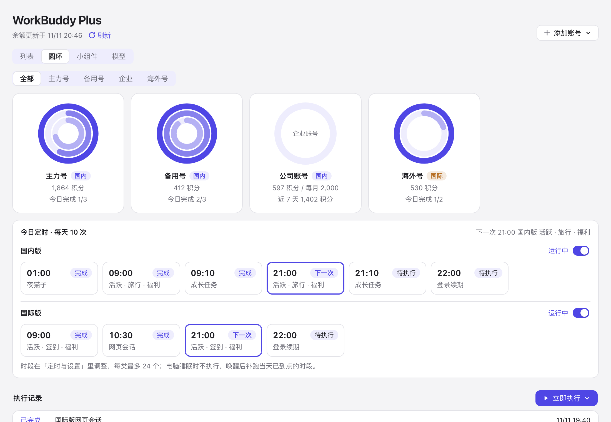
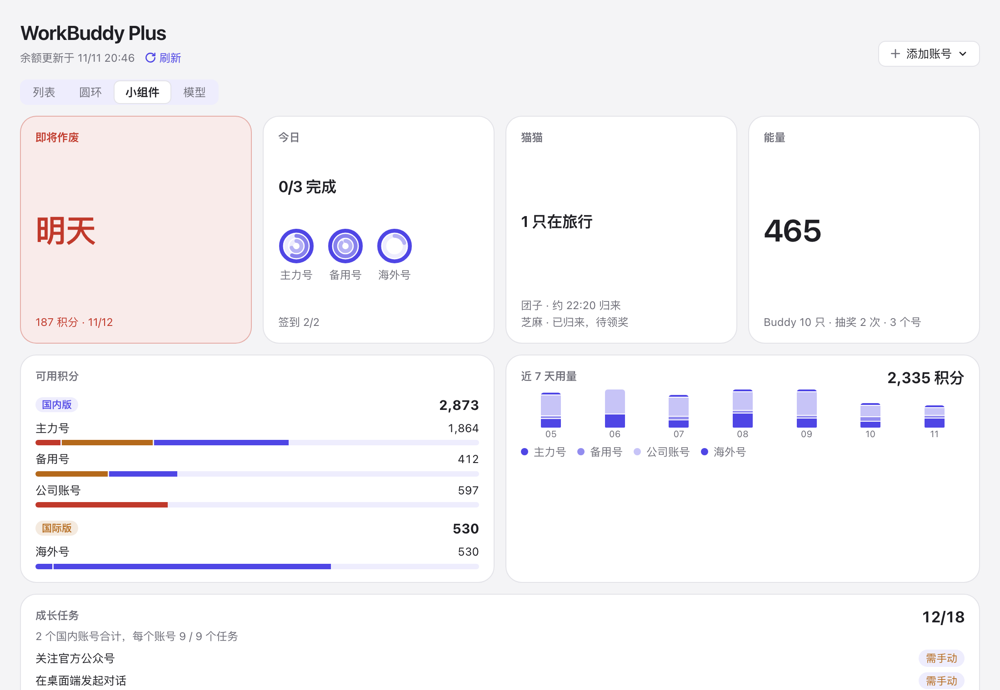
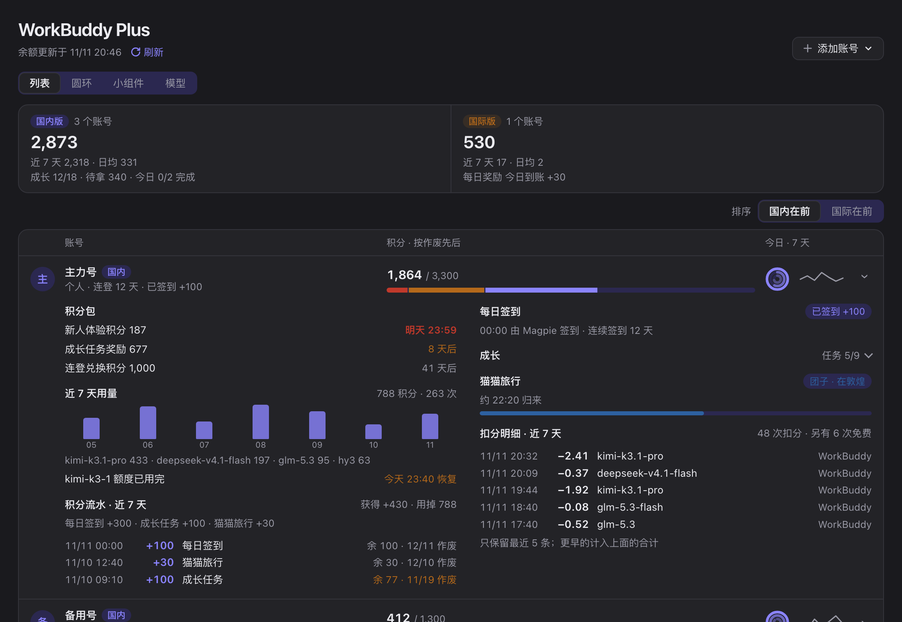

<div align="center">

# WorkBuddy Plus

**A companion plugin for WorkBuddy in Magpie (China and WorkBuddy AI)**<br>
Growth tasks, Buddy travel, login-streak rewards and schedules, plus one board that shows every account at a glance.

[](https://github.com/sabercomo/magpie-workbuddy-plus/actions/workflows/test.yml)
[](LICENSE)

[简体中文](README.md) · **English**

If you find it useful, a ⭐ Star helps others find it too.



</div>

> [!NOTE]
> An unofficial project for WorkBuddy China (the `workbuddy` accounts in Magpie) and WorkBuddy AI, the international build (`workbuddy-ai`). Sign-in, models and API forwarding stay with Magpie's WorkBuddy plugin. **China's daily check-in stays with Magpie** and this plugin never calls China's check-in; Magpie doesn't check in on WorkBuddy AI, so this plugin does, whenever WorkBuddy AI runs a check-in campaign.
>
> The plugin's page and messages are in Chinese. This README gives the Chinese names of buttons and views in quotes so you can find them.

## At a glance

| | |
| --- | --- |
| **Works once installed** | One `magpie plugin add` command. Magpie starts the background service when it launches, and a "WorkBuddy Plus" page appears in its sidebar. |
| **Runs the tasks for you** | Login-streak activity, growth tasks (accept and claim), Buddy travel (send out and claim), streak rewards and the night-owl task, on a schedule, retried on failure. |
| **Account board** | Each account's credits, when each credit package lapses, the last 7 days of usage, and travel and task progress, in switchable views. |
| **Which models you can use** | The Models view (「模型」) lists both builds' models (and an enterprise's, when an enterprise account is added) with their ids, native reasoning levels, context and credit multipliers, sets WorkBuddy AI's Pro-only models apart, and marks subscriber priority and running promotions. |
| **WorkBuddy AI too** | With a WorkBuddy AI login in Magpie, that account is kept active daily, its streak tiers are redeemed, and it checks in whenever a campaign runs. It has its own schedule switch and times, apart from China's. |
| **What needs you** | Credits about to lapse, enterprise allowance resets and logins about to expire, gathered at the bottom of the board. |
| **Add accounts** | A button opens WorkBuddy's official browser sign-in; this plugin never handles a token. |

## Screenshots

The plugin's page in Magpie's light and dark theme; every account and figure is made-up demo data (`sh docs/screenshots.sh` retakes them).

<table>
  <tr>
    <td width="50%"><br><sub><b>Schedule and alerts</b>: a row of slots for China and one for WorkBuddy AI, each with its own schedule switch; spent or queued models and what needs you</sub></td>
    <td width="50%"><br><sub><b>Models · China</b>: each model's id, native reasoning levels, context and multiplier, with subscriber priority, limited-time free and night discounts marked</sub></td>
  </tr>
  <tr>
    <td width="50%"><br><sub><b>Models · WorkBuddy AI</b>: what a Free account can use first, Pro-only models dimmed below</sub></td>
    <td width="50%"><br><sub><b>Models · Enterprise</b>: shown once an enterprise account is added, with the models its enterprise allows</sub></td>
  </tr>
  <tr>
    <td width="50%"><br><sub><b>Rings</b>: each account's activity, travel and task rings; open one for its credit lapse timeline and usage</sub></td>
    <td width="50%"><br><sub><b>Widgets</b>: one fact per tile, summed across accounts</sub></td>
  </tr>
  <tr>
    <td colspan="2"><br><sub><b>Dark mode</b>: follows Magpie's theme</sub></td>
  </tr>
</table>

## Install

First install Magpie's official WorkBuddy plugin, sign in to your China accounts and turn on the daily check-in. You never give this project a password.

Search for this project under Magpie's Plugins → Discover → Unofficial (「插件 → 发现 → 非官方」), or install it directly:

```sh
magpie plugin add github:sabercomo/magpie-workbuddy-plus
```

Then open "WorkBuddy Plus" in Magpie's sidebar (or **http://127.0.0.1:3439**), check the account list and turn on the switches at the right of the 「国内版」 (China) and 「国际版」 (WorkBuddy AI) rows in 「今日定时」 (dark green is running, gray is paused). **Both are paused after a fresh install**; manual runs work either way.

Whenever Magpie starts or reloads plugins, the plugin checks for the local service and starts it from the plugin folder if it isn't running. The service runs on its own: page buttons that make Magpie reload the plugin, and plugin updates, don't interrupt a running job, and it keeps running after you quit Magpie until you log out or shut down. To start it at login, turn on Magpie's login launch (`magpie autostart on`) or use the background install below.

<details>
<summary><b>Optional: run at login on macOS, without Magpie open</b></summary>

Needs Git and Bun 1.3+, with `magpie` and `bun` available in the terminal.

```sh
git clone https://github.com/sabercomo/magpie-workbuddy-plus.git
cd magpie-workbuddy-plus
bun install.mjs
```

The installer copies the runtime files to `~/Applications/Magpie-WorkBuddy-Plus`, registers the Magpie plugin and creates a macOS LaunchAgent that starts at login; any other LaunchAgent for the same folder is unloaded and renamed `.replaced`. You can delete the source folder afterwards.

Only one service holds the port at a time: when the LaunchAgent and Magpie both start one, the later one waits and takes over when the first exits, so nothing runs twice. The service pauses while the computer sleeps and, once awake and online, catches up on the day's slots that came due; the night-owl task only runs inside its night window. Nothing runs while the computer is off.

</details>

<details>
<summary><b>Windows and other platforms</b></summary>

On Windows and Linux, install with `magpie plugin add` too and let Magpie start the service; `bun install.mjs` above is macOS-only and exits with an error elsewhere. Verified on Windows 10 through Magpie; Linux is not yet verified.

Windows reserves some port ranges (for Hyper-V, WSL and others), and the default port 3439 may fall inside one or be taken by another program, including Windows' own HTTP service. The service then doesn't start and writes the reason to `%USERPROFILE%\.config\workbuddy-plus\service.log`. List the reserved ranges with `netsh interface ipv4 show excludedportrange protocol=tcp` and pick a port outside them (see Port under Settings and data).

To run without Magpie, install Bun, sign in to your China accounts and run this in the source folder:

```sh
bun server.mjs
```

Keep it running and start the schedules in the panel. Starting it at boot is up to your system's service manager; that part isn't verified across platforms yet.

</details>

## Features

**Automatic tasks**

- Login-streak activity and reward checks in the China growth center.
- Growth tasks: accept, report events, check progress and claim; a task not reached is never recorded as claimed.
- Buddy travel: send out and claim on return; handles `first_buddy` on first use.
- Streak make-up cards, 7/14/28-day streak exchanges, growth draws, starter packs and event compensation checks. This streak is a different event from the daily check-in credits.
- **WorkBuddy AI (international)**, with its own schedule switch (on its row in 「今日定时」) and times: daily activity that lights the heatmap and builds the streak; the 14-day (+50 credits) and 28-day (+150) tiers redeemed automatically; and the daily check-in whenever WorkBuddy AI runs a campaign (Magpie checks in on China only; as of 2026-11 WorkBuddy AI answers 「签到活动未开启或已过期」, no campaign running, and the plugin starts claiming once one does). WorkBuddy AI's **daily activity reward** (a Bonus Pack of 30 or 50 credits) counts only a finished conversation on its web app, not the desktop activity report, so WorkBuddy AI has a web conversation slot of its own (10:30 by default) that does what workbuddy2api does: it opens a conversation through the workbuddy.ai web channel, asks for a one-word reply, waits for it to finish and ends it, once a day. The model is picked automatically from those free right now (such as Hy3 while it's free, which cost nothing when measured); with none free, or if the free one turns it down (its daily free allowance spent, say), DeepSeek-V4.1-Flash runs it instead (about 0.6 credits). A model can also be set in 「定时与设置」. Clear the slot, or set `"intlWeb": false` in `config.json`, to stop it. WorkBuddy's usage list usually shows one web conversation as two requests a few seconds apart. The reward does not land when the conversation ends: it has arrived the night after the active day (02:00 to 07:00 Beijing time). The board shows 「每日活跃奖励 今日到账 +30」 or 「今日未到账」 for WorkBuddy AI accounts, and the credit history names that grant 「每日活跃奖励」. WorkBuddy AI's growth tasks (its 「养虾」 levels) count real use of its client and can't be simulated, so the board and the reminders no longer list them; with no check-in campaign running, no check-in is shown; it has no Buddy travel, so none is asked for, logged or shown, and its board rings are just activity and growth tasks.
- The night-owl task runs inside its valid window in Beijing time, at most once per account per day.
- Login renewal checks (China and WorkBuddy AI alike, under the file locks Magpie uses, so neither overwrites the other), retries, catch-up after sleep for the day's slots, and no double runs after a restart.

**Account board** (read only; refreshes with the service every 10 minutes, and shows China accounts signed in or out in Magpie within half a minute; claims or spends nothing)

- Credit history (「积分流水」): WorkBuddy keeps every grant (a check-in, a task reward, a Buddy's trip…) as its own entry with the time it was given. An account's detail lists the grants of the last seven calendar days (today included, the same days the usage total covers): when, how much, where from, what's left and when it lapses, under totals by source (say 「每日签到 +700 · 成长任务 +200 · 猫猫旅行 +43」) and the credit used meanwhile. The source is read from the line of this plugin's run log with the same time and amount, and China's daily check-in from Magpie's check-in time; a grant matching neither shows its package name.
- Deductions (「扣分明细」): in the detail's right column, beside the credit history, the week's 50 most recent requests that cost credit, one row each: when, how much (to two decimals), the model and the client that sent it. Ten show; the rest open under 「再显示」. Above them, how many requests were charged and how many were free; older requests count only in the totals.
- Model limits (「模型限额」): besides credits, each model has its own 24-hour allowance on each account; once it's spent, the model is refused (HTTP 429, code 6004) until it resets. WorkBuddy doesn't say how much is left, so the board checks models used in the last 24 hours with one minimal request (a fixed system prompt and "Hi", at most 16 tokens, no reasoning): a spent model answers with its reset time and costs nothing; a live one cost 0 credits when measured. A model is asked again only after it was used since the last check, at most hourly, and never before a known reset. Spent models show under 「近 7 天用量」 in the account's detail and in the yellow 「模型额度用完」 box at the bottom, with when they come back.
- Model queues (「排队中」): when a model is short of capacity, WorkBuddy queues requests and answers HTTP 429 too (code 6020, with the queue position and estimated wait), **enterprise accounts included**, however much allowance they have. Tools like Magpie retry a few times and then report `exceeded retry limit, last status: 429`. The check above records the position and when the wait should be over, shows it in the account's detail and the same yellow box, and drops it once that time passes; a queued model is checked again at most hourly.
- An account's 「成长」 (energy, Buddies, the next streak tier and open tasks) starts folded; click 「任务 x/y ▾」 to open it.
- A package is counted grant by grant: every reward in 「国内运营裂变包」, for one, is its own grant with its own 20 days, so only the grants about to lapse turn red and count as lapsing, never the whole package.
- List (「列表」): a summary card each for China and WorkBuddy AI on top (their credits are separate wallets, never added together; WorkBuddy AI's says whether today's daily reward has landed), a 「国内」/「国际」 tag on every account when both are present, and a 「国内在前」/「国际在前」 (China first / WorkBuddy AI first) switch at the right, remembered and followed by the rings and widgets; below it one row per account (credit bar coloured by each grant's own lapse date, today's rings, a 7-day trend); open a row for packages, usage, tasks and travel.
- Rings (「圆环」): one account at a time with today's rings (activity, travel, tasks), a credit lapse timeline and usage.
- Widgets (「小组件」): one fact per tile across all accounts: next lapse, today, Buddies, energy, credits (a subtotal each for China and WorkBuddy AI), 7-day usage, growth tasks.
- Models (「模型」): switch between China (「国内版」) and WorkBuddy AI (「国际版」); with an enterprise account added, an 「企业」 tab comes first with the models that account may use (set by its enterprise, not the personal list), and without one it isn't shown. Models the current plan can use come first; WorkBuddy AI's Pro-only models are dimmed below. Each row has the model id (click to copy), reasoning levels, context and multiplier. Reasoning levels are each model's native ones from WorkBuddy's config (such as `low high max`), the default in bold, 「可关」 when thinking can be switched off, 「固定」 when there is only one, 「—」 when none are listed; multipliers of 3 or more are orange, and limited-time free, night discounts and subscriber priority follow WorkBuddy's own labels. WorkBuddy AI needs a `workbuddy-ai` sign-in in Magpie.
- At the bottom, today's schedule (「今日定时」) shows each slot's result and the next run; below it, the alerts: spent models in a yellow box (「模型额度用完」); a login about to expire, a failed read and credit lapsing within 2 days in a red one (「需要你处理」); everything else (credit lapsing within 10 days, enterprise allowance resets, check-in notes) in a plain list (「其他提醒」), folded until opened.
- Each personal account shows today's daily check-in: for China, Magpie's record (checked in +100, not yet, needs the WorkBuddy client…), with a switched-off or missed check-in in the alerts; for WorkBuddy AI, this plugin's own result, or 「暂无签到活动」 (no campaign) while none runs. Enterprise accounts have no daily check-in credits and show none. WorkBuddy AI accounts are tagged 「国际版」 in the list.
- Enterprise accounts show their monthly allowance, usage and reset time.

**Entry points**

- Magpie's sidebar page: 「添加账号」 (add account, China or WorkBuddy AI) at the top right; 「刷新」 (refresh) beside the update time; in the board's 「今日定时」, a China row and a WorkBuddy AI row, each with a switch that pauses or starts that build's schedule (it only stops schedules; manual runs still work); and 「立即执行」 (run now) beside the run history, with 「全部跑一遍」 (everything), 「只放猫猫旅行」 (Buddy travel only) and 「只做成长任务」 (growth tasks only). 「定时与设置」 at the bottom has a China and a WorkBuddy AI group with each build's times and the web conversation's model, plus the random offset, the time zone and the proxy (for setups such as Docker where the local panel can't be reached).
- The local panel at http://127.0.0.1:3439 (local access only, so not from outside when Magpie runs in Docker): the same board, plus running selected accounts, the last 100 runs, and editing schedules and the proxy.
- Add account (「添加账号」) offers China or WorkBuddy AI and runs Magpie's own `magpie plugin login workbuddy` or `magpie plugin login workbuddy-ai`, which opens the official browser sign-in; signing in to an account again replaces its old login. This plugin never touches login tokens and offers no account file import or export.

> [!IMPORTANT]
> Growth tasks include simulated client event reports; they don't mean the action was really done in the desktop client. Whether they count, pay out, or get an account restricted is up to WorkBuddy, and not every task can be completed. Following the official account, real donations and sharing a skill need you and are no longer listed (nor counted in the task total); once reached they are still claimed. Besides the ordinary tasks, three kinds are reported as another client would: the desktop client's (a desktop chat, entering a Buddy app, 企鹅教师助手), the web app's (reading the library's introduction) and the mini program's own (`Sequential_Tasks_1` to `3`: one chat, one expert chat, five chats). The mini program's tasks unlock one a day, each after the one before it is claimed, and its chats are reported at a person's pace (about 45 seconds apart, since a burst is rolled back), so the five-chat task takes about four minutes. Their event shapes follow [workbuddy2api-panel](https://github.com/misakano7545/workbuddy2api-panel).

## Default schedule

All times are `Asia/Shanghai` and can be changed in the panel; clearing a kind's times turns that kind off.

| Time | China | WorkBuddy AI |
| --- | --- | --- |
| 01:00 | Night-owl task | — |
| 09:00, 21:00 | Activity, Buddy travel, streak rewards | Activity, check-in, streak rewards |
| 09:10, 21:10 | Growth tasks | — |
| 10:30 | — | Web conversation (daily activity reward, once a day) |
| 22:00 | Login renewal check, renewing two hours ahead | Login renewal check |

Each build's times are edited in 「定时与设置」 and paused with the switch on its row in 「今日定时」. WorkBuddy AI's growth-task slot is gone from 0.5.9 (its tasks count only real use of its client, and the slot never claimed anything); a saved one is ignored. Upgrading from 0.5.6 or earlier, WorkBuddy AI keeps the times it had, with the web conversation at 10:30; if 「国际版任务」 was off, its schedule stays paused.

Each slot runs at a random moment around its set time (±10 minutes by default, different every day and on every computer; the night-owl task stays inside 23:00–08:00), and a scheduled run waits a random 5–45 seconds between accounts, so not everyone reaches WorkBuddy on the hour. Change it with 「随机错开」 under the panel's settings; 0 turns it off. The board's 「今日定时」 shows when each slot runs today. Schedules are checked every 30 seconds. A failure is retried at least 15 minutes later, up to 3 tries per slot. When WorkBuddy rate-limits (HTTP 429) the run first waits and retries; a run still limited is marked "retry later" (「稍后重试」) rather than failed, and is retried on the same spacing. Each kind takes up to 24 times. Streak activity doesn't repeat once it succeeded that day; travel and task rewards are checked against WorkBuddy's state. China's daily check-in follows Magpie's own setting and is not one of this plugin's schedules; WorkBuddy AI's check-in runs in the activity, travel and streak-rewards slots.

## Tools and terminal

The plugin's card under Plugins → Installed shows its tool names and lets you copy Magpie's MCP address.

| Tool | Use |
| --- | --- |
| `status` | China accounts, runs and schedule settings |
| `run` | Start an action; `all` covers activity, growth tasks, travel and streak rewards |
| `schedules` | Show or switch schedules (`enabled` for China, `intlEnabled` for WorkBuddy AI); times are edited in the web panel |
| `board` | The account board: credits, package lapse dates, 7-day usage, travel and streak |

In the source or install folder you can also use the terminal:

```sh
bun cli.mjs status
bun cli.mjs run all
bun cli.mjs board
bun cli.mjs pause
bun cli.mjs resume
```

`run` also takes `activity`, `tasks`, `travel`, `bonus`, `night`, `keepalive` and `inspect`. Each returns a run id; check the result in the panel or with `status`.

<details>
<summary><b>How the Magpie page works</b></summary>

Magpie runs plugin pages in a sandbox with no network, so the page reads `page/data.js`, which the service writes (balances, usage and travel only, no credentials), and reloads it every 15 seconds; after a plugin update an open page loads the new version by itself. The page's buttons submit requests by saving them into the plugin's options, which makes Magpie reload the plugin once and hand the request to the service; each request runs once, and one older than 10 minutes is refused. The page says so when its data is more than 25 minutes old.

</details>

## Settings and data

| Location | Contents |
| --- | --- |
| `~/.config/workbuddy-plus/config.json` | China's schedule switch and times (`enabled`, `schedules`), WorkBuddy AI's (`intlEnabled`, `intlSchedules`), the random offset in minutes (`spread`), account switches, WorkBuddy AI's daily web conversation and its model (`intlWeb`, `intlWebModel`; `auto` picks a free one) and HTTP proxy |
| `~/.config/workbuddy-plus/state.json` | Run history and de-duplication state |
| `~/.config/workbuddy-plus/service.log` | Service log |
| `page/data.js` in the plugin folder | The board snapshot for Magpie's page, rewritten by the service |
| `~/Library/LaunchAgents/io.github.sabercomo.magpie-workbuddy-plus.plist` | macOS background start (optional install) |

China logins are read from `~/.config/magpie/plugin-auth.json`. When Magpie uses a custom config folder, `XDG_CONFIG_HOME` is followed, or point `WORKBUDDY_PLUS_MAGPIE_DIR` at it; `WORKBUDDY_PLUS_DIR` sets this plugin's data folder.

**Port**: the service listens on `127.0.0.1:3439`. When it runs from Magpie, change it with the plugin option:

```sh
magpie plugin options <plugin name> '{"port":4389}'
```

The plugin name is the one `magpie plugin list` shows. When you start the service without Magpie, use the `WORKBUDDY_PLUS_PORT` environment variable; the macOS background install reads it when you run `bun install.mjs`, so to change the port later, install again with the new value and keep the plugin option on the same port. A port taken by another program or reserved by the system doesn't make the service wait: it writes the reason and exits. Only when a WorkBuddy Plus is already running on that port does a new service wait to take over.

<details>
<summary><b>What the board reads</b></summary>

The board only reads `get-user-resource` (credit packages; `get-enterprise-user-usage` for an enterprise account's monthly allowance), `get-user-request-usage` (official usage: credits, requests and models, plus the time, credit, model and client of the 50 most recent charged requests as the deductions list; request contents are not kept) and the growth center's tasks, energy, Buddy collection, draw count, travel and streak state. It claims nothing. The only chat request it sends is the model-limit check (`/v2/chat/completions`, always just "Hi"; see 「模型限额」 above), carrying none of your conversations. Enterprise accounts show only their allowance and usage. China's daily check-in result is read from Magpie's own `plugin-checkin.json` and its switch; this plugin never calls China's check-in endpoint. For WorkBuddy AI it reads `checkin-activity-status` and calls `daily-checkin` when a campaign runs and today isn't claimed yet.

The Models view reads both builds' `/v3/config` (the WorkBuddy client's own model config: models, multipliers, the Pro Only and subscriber-priority tiers, promotions) and `get-user-resource-summary` (the account's plan). It calls no model and spends no credits. The China list is read with the first personal account, the enterprise list with the first enterprise account, the WorkBuddy AI list only with the `workbuddy-ai` account signed in to Magpie.

The plugin works with Magpie through its local account file, renewing logins under the same file and account locks Magpie uses. A change in Magpie's storage format may need an update here. Released source contains no personal account files, settings or run history.

The service listens on `127.0.0.1` only. An HTTP proxy can be set in the panel; proxied requests need Bun. Node.js 22+ can run the tests, or the service without a proxy.

</details>

## Updating and stopping

Installed from Magpie: run `magpie plugin update`. If you installed a pinned version (`magpie plugin list` shows a suffix like `#v0.4.0`), remove it with `magpie plugin rm` and `magpie plugin add` the unpinned address again; plugin options such as the port need setting again. From 0.5.5 on, when Magpie loads the updated plugin it finds the older service, asks it to exit and starts the new version, so no restart is needed (with a job running it waits for it, asking again each minute). Coming from 0.5.4 or earlier, the old service doesn't know that request yet: end it one last time (or log out, restart, or restart the container).

The macOS background install: update the source folder and install again; settings and history are kept.

```sh
git pull --ff-only
bun install.mjs
```

Turning the plugin off in Magpie only turns off its tools. **To stop automatic tasks, switch off both the China and the WorkBuddy AI rows in 「今日定时」 first**, or run `bun cli.mjs pause` (pauses both).

<details>
<summary><b>Removing the macOS background install completely</b></summary>

```sh
launchctl bootout "gui/$(id -u)" "$HOME/Library/LaunchAgents/io.github.sabercomo.magpie-workbuddy-plus.plist"
magpie plugin rm "$HOME/Applications/Magpie-WorkBuddy-Plus"
```

Then delete the install folder and the plist above. Settings and history in `~/.config/workbuddy-plus` can stay. If you also installed the plugin by its repository address, remove that entry from Magpie's installed list too.

</details>

## Development

No npm dependencies to install. Tests use mock accounts and a mock upstream, and never touch a personal account or a real reward endpoint.

```sh
npm test
```

The tests cover China and WorkBuddy AI account selection, each build's own schedule switch and times (with settings from older versions), the web conversation's model choice and fallback, WorkBuddy AI tasks and check-in, credentials kept out of status replies, run-all never calling the daily check-in, growth task progress, travel rewards, package merging and lapse dates, task categories, usage paging and deductions, model limits and queues (reset parsing, queue detection and when to ask), the service handoff after an update, settings saved from Magpie's page, WorkBuddy AI's web conversation and daily reward, board snapshots without credentials, page request de-duplication, rate-limit retries, the add-account flow, login renewal races, schedule de-duplication, the panel and the local HTTP boundary, the model catalog, and the service port.

The README screenshots come from `sh docs/screenshots.sh`: `docs/demo-data.mjs` writes made-up accounts and headless Chrome renders the page in Magpie's theme.

The repository carries the `magpie-plugin` GitHub topic so Magpie's unofficial Discover section can find it; that doesn't mean Magpie's maintainers reviewed or recommend it.

## License and credits

MIT. Credit package merging and usage paging are adapted from [zseeu1/wbkit](https://github.com/zseeu1/wbkit) (MIT); reading the enterprise allowance follows Magpie's WorkBuddy plugin. Where the task codes, endpoints and login fields come from, and their licenses, are in [THIRD_PARTY_NOTICES.md](THIRD_PARTY_NOTICES.md).
