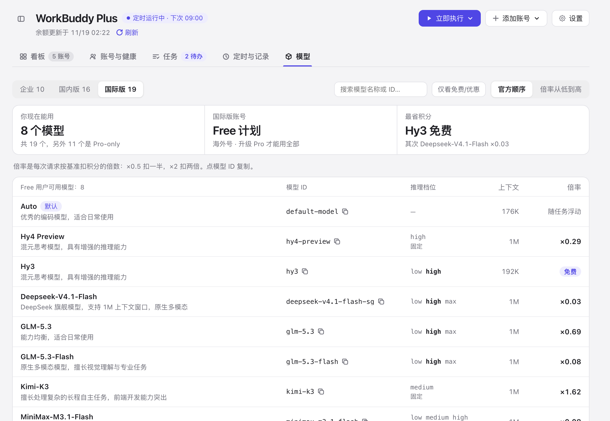
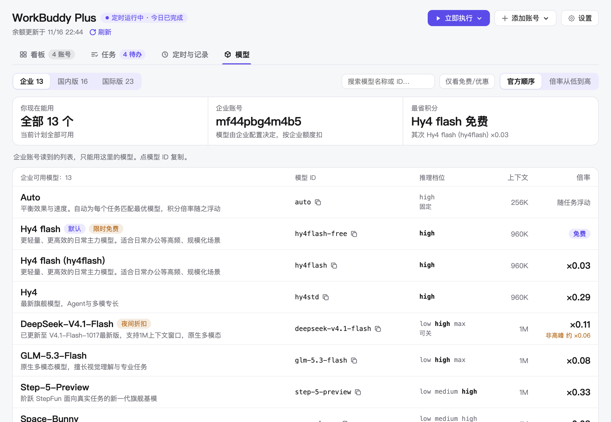
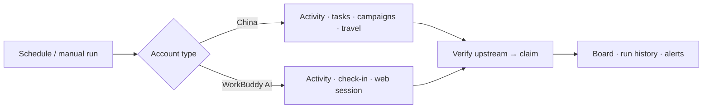

<div align="center">

# WorkBuddy Plus

**A companion plugin for WorkBuddy in Magpie (China and WorkBuddy AI)**<br>
Growth tasks, Buddy travel, login-streak rewards and schedules, plus one board that shows every account at a glance.

[](https://github.com/sabercomo/magpie-workbuddy-plus/actions/workflows/test.yml)
[](LICENSE)

[简体中文](README.md) · **English**

If you find it useful, a ⭐ Star helps others find it too.


</div>

> [!NOTE]
> An unofficial project for WorkBuddy China (the `workbuddy` accounts in Magpie) and WorkBuddy AI, the international build (`workbuddy-ai`). Sign-in, models and API forwarding stay with Magpie's WorkBuddy plugin. **China's daily check-in stays with Magpie** and this plugin never calls China's check-in; Magpie doesn't check in on WorkBuddy AI, so this plugin does, whenever WorkBuddy AI runs a check-in campaign.
>
> The plugin's page and messages are in Chinese. This README gives the Chinese names of buttons and views in quotes so you can find them.

## At a glance

<table>
  <tr><td><strong>Works once installed</strong></td><td>One <code>magpie plugin add</code> command. Magpie starts the background service when it launches, and a "WorkBuddy Plus" page appears in its sidebar.</td></tr>
  <tr><td><strong>Runs the tasks for you</strong></td><td>Login-streak activity, growth and campaign tasks, claim-only sweeps, Buddy travel (send out and claim), streak rewards and the night-owl task, on a schedule, retried on failure.</td></tr>
  <tr><td><strong>Account board</strong></td><td>Each account's credits, when each credit package lapses, the last 7 days of usage, and travel and task progress, in switchable views; the nav is horizontal by default and the fixed button to the left of the title switches to a sidebar and remembers the choice.</td></tr>
  <tr><td><strong>Which models you can use</strong></td><td>The Models view (「模型」) lists both builds' models (and an enterprise's, when an enterprise account is added) with their ids, native reasoning levels, context and credit multipliers, sets WorkBuddy AI's Pro-only models apart, and marks subscriber priority and running promotions.</td></tr>
  <tr><td><strong>WorkBuddy AI too</strong></td><td>With a WorkBuddy AI login in Magpie, that account is kept active daily, its streak tiers are redeemed, and it checks in whenever a campaign runs. It has its own schedule switch and times, apart from China's.</td></tr>
  <tr><td><strong>What needs you</strong></td><td>Credits about to lapse, enterprise allowance resets and logins about to expire, gathered at the bottom of the board; exhausted or queued models get their own model-quota card.</td></tr>
  <tr><td><strong>Add accounts</strong></td><td>Open WorkBuddy's official browser sign-in for China or WorkBuddy AI. Magpie still handles sign-in and renewal.</td></tr>
  <tr><td><strong>Manage accounts across devices (trial)</strong></td><td>In Magpie, open WorkBuddy Plus → Settings → Account sync (「账号同步」) to share selected accounts, see device status, or switch the sync master. Sync uses the private storage configured in Magpie and is off by default. <a href="#manage-accounts-across-devices">Instructions</a></td></tr>
</table>

## Screenshots

The plugin's page in Magpie's light and dark theme; every account and figure is made-up demo data (`sh docs/screenshots.sh` retakes them).

<table>
  <tr>
    <td width="50%"><br><sub><b>Main page · List</b>: China and WorkBuddy AI groups with credits, today's rings and the 7-day trend; open an account for its full detail</sub></td>
    <td width="50%"><br><sub><b>Tasks</b>: growth tasks and progress by account in natural-height columns, with travel + Buddy blind boxes and compensation + campaigns in two rows below; account cards and extras drag to reorder</sub></td>
  </tr>
  <tr>
    <td colspan="2"><br><sub><b>Accounts & health</b>: filter all, China personal, WorkBuddy AI personal, enterprise or abnormal accounts; expand for failure diagnostics, with three equal-width batch actions when selected</sub></td>
  </tr>
  <tr>
    <td width="50%"><br><sub><b>Rings</b>: each account's activity, travel and task rings; open one for its credit lapse timeline and usage</sub></td>
    <td width="50%"><br><sub><b>Widgets</b>: one fact per tile, summed across accounts</sub></td>
  </tr>
  <tr>
    <td width="50%"><br><sub><b>Models · China</b>: each model's id, native reasoning levels, context and multiplier, with subscriber priority, limited-time free and night discounts marked</sub></td>
    <td width="50%"><br><sub><b>Models · WorkBuddy AI</b>: what a Free account can use first, Pro-only models dimmed below</sub></td>
  </tr>
  <tr>
    <td width="50%"><br><sub><b>Models · Enterprise</b>: shown once an enterprise account is added, with the models its enterprise allows</sub></td>
    <td width="50%"><br><sub><b>Alert footer</b>: spent or queued models, expired logins, lapsing credits and network pauses grouped by reason; other reminders stay folded</sub></td>
  </tr>
  <tr>
    <td colspan="2"><br><sub><b>Dark mode</b>: follows Magpie's theme</sub></td>
  </tr>
</table>

## Install

First install Magpie's official WorkBuddy plugin, sign in to your China accounts and turn on the daily check-in. You never give this project a password.

Search for this project under Magpie's Plugins → Discover → Unofficial (「插件 → 发现 → 非官方」), or install it directly:

```sh
magpie plugin add github:sabercomo/magpie-workbuddy-plus
```

Then open "WorkBuddy Plus" in Magpie's sidebar (or **http://127.0.0.1:3439**), check the account list and turn on the switches at the right of the 「国内版」 (China) and 「国际版」 (WorkBuddy AI) rows in 「今日定时」 (dark green is running, gray is paused). **Both are paused after a fresh install**; manual runs work either way.

Whenever Magpie starts or reloads plugins, the plugin checks for the local service and starts it from the plugin folder if it isn't running. The service runs on its own: page buttons that make Magpie reload the plugin, and plugin updates, don't interrupt a running job, and it keeps running after you quit Magpie until you log out or shut down. To start it at login, turn on Magpie's login launch (`magpie autostart on`) or use the background install below.

<details>
<summary><b>Optional: run at login on macOS, without Magpie open</b></summary>

Needs Git and Bun 1.3+, with `magpie` and `bun` available in the terminal.

```sh
git clone https://github.com/sabercomo/magpie-workbuddy-plus.git
cd magpie-workbuddy-plus
bun install.mjs
```

The installer copies the runtime files to `~/Applications/Magpie-WorkBuddy-Plus`, registers the Magpie plugin and creates a macOS LaunchAgent that starts at login; any other LaunchAgent for the same folder is unloaded and renamed `.replaced`. You can delete the source folder afterwards.

Only one service holds the port at a time: when the LaunchAgent and Magpie both start one, the later one waits and takes over when the first exits, so nothing runs twice. The service pauses while the computer sleeps and, once awake and online, catches up on the day's slots that came due; the night-owl task only runs inside its night window. Nothing runs while the computer is off.

</details>

<details>
<summary><b>Windows and other platforms</b></summary>

On Windows and Linux, install with `magpie plugin add` too and let Magpie start the service; `bun install.mjs` above is macOS-only and exits with an error elsewhere. Verified on Windows 10 through Magpie; Linux is not yet verified.

On Windows, the built-in Windows PowerShell and WMI launch the background service independently. Reloading Magpie plugins leaves the same-version service listening on its local port.

Windows reserves some port ranges (for Hyper-V, WSL and others), and the default port 3439 may fall inside one or be taken by another program, including Windows' own HTTP service. The service then doesn't start and writes the reason to `%USERPROFILE%\.config\workbuddy-plus\service.log`. List the reserved ranges with `netsh interface ipv4 show excludedportrange protocol=tcp` and pick a port outside them (see Port under Settings and data).

If the local panel times out, check the listener and TCP connectivity in PowerShell. If you changed the port, replace `3439` in both commands.

```powershell
Get-NetTCPConnection -LocalAddress 127.0.0.1 -LocalPort 3439 -State Listen
Test-NetConnection 127.0.0.1 -Port 3439
```

If a listener is present and `TcpTestSucceeded` is `False`, get the listener's path with `Get-Process -Id <OwningProcess> | Select-Object Id, Path` and review the firewall or endpoint security rules for that process. If an allow rule is needed, have an administrator scope it to the actual `magpie-bun.exe`, the loopback address, and the Plus port. Then retry the local panel and sidebar. This check can be done with schedules off and without running tasks. [Windows TCP troubleshooting](https://learn.microsoft.com/en-us/troubleshoot/windows-client/networking/tcp-ip-connectivity-issues-troubleshooting)

To run without Magpie, install Bun, sign in to your China accounts and run this in the source folder:

```sh
bun server.mjs
```

Keep it running and start the schedules in the panel. Starting it at boot is up to your system's service manager; that part isn't verified across platforms yet.

</details>

## Features

- **Automatic tasks:** China runs growth tasks, Buddy travel and streak rewards. WorkBuddy AI has its own schedule for activity, streak rewards and check-in when a campaign runs. Magpie still handles China's daily check-in.
- **Multi-account board:** Check credit balances, expiry dates and 7-day usage together. Personal credits and enterprise allowances stay separate.
- **Tasks and account health:** In Tasks, see progress for China personal accounts, run individual tasks or claim rewards. In Accounts & health, diagnose, retry or pause an account's tasks.
- **Model catalog:** See the models available to China, WorkBuddy AI and enterprise accounts, with their reasoning levels, context sizes and credit multipliers.

[Screenshots](#screenshots) · [Default schedule](#default-schedule) · [Settings and data](#settings-and-data)

> [!IMPORTANT]
> - Some growth tasks report simulated client events; this does not mean the action took place in the desktop client.
> - WorkBuddy decides what counts, which rewards are paid and whether an account is restricted. Not every task can be completed.
> - Campaign App chats and WorkBuddy AI web chats may spend credits. Buddy blind boxes spend growth energy.

<details>
<summary>Full feature reference</summary>

- Following the official WeChat account and making donations must be done manually. Skill sharing creates a real channel and reports the result without sending a WeChat message. Rewards are claimed only after the service confirms completion.
- Desktop, web and mini-program event formats follow [workbuddy2api-panel](https://github.com/misakano7545/workbuddy2api-panel).



| Area | What you can do |
| --- | --- |
| Automatic tasks | Schedule each version separately and retry failed runs. See the rules and switches below. |
| Tasks | Check per-account progress and handle growth tasks, travel, blind boxes, compensation and campaigns. |
| Board and health | Use list, rings or widgets to check accounts. Diagnose issues, pause work or retry in Accounts & health. |
| Models | Browse each version's catalog and see recorded quota or queue events. |
| Access | Use the Magpie sidebar, local panel, CLI or MCP. |

### Full automatic-task rules

**China: growth tasks and campaigns**

| Task | How it runs |
| --- | --- |
| Growth and streaks | Checks streak activity and rewards in the Growth Center. Accepts tasks, reports events and checks progress before claiming. Incomplete tasks are not marked claimed. |
| Desktop and web | Supports desktop chats, opening a Buddy app, 企鹅教师助手, and reading the web library introduction. |
| Mini-program tasks | `Sequential_Tasks_1` to `7` cover chats, an expert, GLM5.2, creating a scheduled task, ten chats and the PC playbook task. One unlocks per day after the previous reward is claimed. |
| Mini-program chats | Roughly 45 seconds between reports; WorkBuddy rolls back bursts. |
| New expert tasks | Reads the task's `jump_url` for an `expertId`, including `deeplink` and `expert_use_<slug>`. Unrecognized tasks are marked manual on the account's task card. |
| Skill sharing | Creates a real share channel and reports using its channel ID. Reuses the same account's channel that day; claims only after the service confirms completion. Turning off automatic sharing skips it in bulk runs; individual runs still work. |
| Campaigns | Reads progress for events such as Starbucks and Reporter's Day. Runs supported chat, expert, skill and desktop tasks and claims rewards once reached. Invitations are manual; ended campaigns are skipped. |
| Campaign App chat | Runs one real cloud App chat before claiming and **may spend credits**. Off by default; scheduled and run-all jobs skip it, Tasks shows 「设置已关闭」, and other tasks still run. |
| Manual tasks | Following the official account and donating are not shown or counted. Rewards are claimed once WorkBuddy confirms completion; following requires 24 hours according to WorkBuddy's progress. |
| Claim-only sweep | Accepts pending tasks and claims reached growth or campaign rewards without sending behavior events. Runs separately from growth tasks, or manually via 「补领奖励」 without signing in to each account. |

**China: travel, rewards and check-in**

| Task | How it runs |
| --- | --- |
| Buddy travel | Sends Buddy out and claims on return; handles `first_buddy` on first use. |
| Streaks and packs | Processes streak make-up cards, 7/14/28-day exchanges, growth draws, starter packs and campaign compensation. Streak make-up is separate from daily check-in. |
| Official compensation | Reads `compensation-status` and claims only active, unclaimed compensation with quota. Inactive or already claimed is not a failure; failed reads are shown separately. |
| Buddy blind boxes | Opening manually in Tasks **spends growth energy**. Automatic opening after travel is off by default. If enabled, it opens once when Buddy is idle and eligible to depart. |
| Blind box checks | Both modes check travel state and skip while in transit, awaiting a reward or unsure of the state. A confirmed account without Buddy can open its first box. |
| Growth draws and physical prizes | Run history records prize names. A physical prize or address flag prompts you to enter shipping details in the Growth Center and links to the record. It stays visible while the record is retained; response fields need live-account verification. |
| Daily check-in | Magpie claims it. The plugin reads `checkin-activity-status` to verify and uses the newer same-day record. |
| Night-owl task | Runs within the eligible Beijing-time window, at most once per account per day. |

The automatic switches for skill sharing, campaign App chats and blind boxes are in Settings › Tasks & conversation.

**WorkBuddy AI (international)**

| Task | How it runs |
| --- | --- |
| Schedule and streaks | Separate switch and times under Today's Schedule. Activity lights the heatmap and builds the streak; day 14 redeems 50 credits, day 28 redeems 150. |
| Daily check-in | The plugin checks in when a campaign is active; otherwise no check-in is shown. The November 2026 observation was 「签到活动未开启或已过期」; check-in resumes when a campaign opens. |
| Daily activity reward | A Bonus Pack of 30 or 50 credits requires one completed web chat. Desktop activity reports do not count. |
| Web conversation | Defaults to 10:31, once a day. Creates a chat via workbuddy.ai, asks for a one-word reply, waits for completion and ends the chat. WorkBuddy normally lists two usage requests. |
| Models and credits | Picks an available free model first. Hy3 was measured as free during its offer. With no usable free model it falls back to DeepSeek-V4.1-Flash (about 0.6 credits). You can choose a model in Settings. Only an explicit model quota refusal during conversation creation triggers a fallback. An account error, a full session list, or a failure after creation does not start a second conversation. |
| Turn off web chats | Disable the daily web conversation in Settings or clear its slot. No activity reward is earned through the automated chat, but the streak continues. |
| Reward arrival | Observed the following morning at 02:00–07:00 Beijing time. The board shows today's amount or that it hasn't arrived; credit history labels it a daily activity reward. |
| Limits | Growth levels count real client use only; the plugin does not simulate them or list them on the board or in alerts. No Buddy travel is requested, tracked or displayed; rings show activity and growth only. |

**Failures, sleep and restart**

| Situation | What happens |
| --- | --- |
| Three days of format failures for one task | HTTP 400 from `/v2/report` pauses automatic reporting for that task. A successful manual run clears the pause. |
| Three consecutive network or proxy errors | Timeouts, refused connections or resets (`ECONNRESET`) pause automatic runs for 10 minutes. A successful manual run clears the pause. |
| Wake or restart | Catches up on slots due that day after sleep, retries failures and avoids duplicate runs after a restart. |

### Board views and account details

**Accounts and credits**

| Where | What it shows |
| --- | --- |
| Updates and balances | Read-only, refreshed every three minutes. China accounts signed in or out in Magpie appear within half a minute. Personal totals are separate by version, to two decimal places. |
| Enterprise allowances | Separate from personal credits. Shows monthly team allowance, usage, reset time and daily team totals. Requests from this account are folded separately. |
| Credit history | Seven days of grants, with time, amount, source, credit left and expiry, plus totals by source and spending. Same-name grants expire separately; each 「国内运营裂变包」 grant has its own 20 days. |
| Credit sources | Uses the grant reason first, then matching run history or Magpie check-in. Unmatched items are marked “source unconfirmed”; reason coverage needs live-account verification. |
| Charges | Up to 50 charged requests in the last seven days, with time, cost to two decimal places, model and client. Shows 10 initially; choose Show more for the rest. |
| Request totals | Shows charged and free counts; earlier requests count only in totals. |
| Growth and campaigns | Open the task count to see energy, Buddies, streak tiers and unfinished tasks. Campaigns show progress and claim state. Manual items such as invitations appear in Tasks only. |
| Daily check-in | China personal accounts show Magpie's result and alert on missed or disabled check-in. WorkBuddy AI shows the plugin result or no campaign. Enterprise has no check-in row. |

**Views and operations**

| View | How to use it |
| --- | --- |
| List groups | China and WorkBuddy AI each show their balance and account count. China shows today's progress, growth and 7-day use; WorkBuddy AI shows today's reward and 7-day use. |
| Group order | Move the lower group up to reorder the list, rings and widgets. Personal accounts come first. Open an account for credit packages, usage, tasks and travel. |
| Account rows | Collapsed by default, with a credit bar colored by each grant's expiry, today's rings and a 7-day trend. WorkBuddy AI accounts carry the international label. |
| Rings | One account at a time: activity, travel and task rings, expiry timeline and usage. |
| Widgets | One measure per tile: expiring credits, today, Buddies, energy, personal credits by version, enterprise allowance, 7-day use and growth tasks. |
| Task filters | China personal accounts only. Filter by claimable, automatic, manual or locked; group by account or state. |
| Task order | Drag the six-dot handle or use Alt+arrows to reorder accounts and the four cards. Order is saved locally; status grouping remains by state. Cards keep their own height. |
| Task actions | Travel sits beside blind boxes, and compensation beside campaigns. Travel can be claimed and sent at once; open boxes and claim compensation per account or in bulk; campaign actions follow the status. |
| Model catalog | China and WorkBuddy AI each have lists; WorkBuddy AI requires a `workbuddy-ai` sign-in. An enterprise tab appears only for an enterprise login and follows its own configuration. |
| Model information | Available models come first; WorkBuddy AI Pro-only models are dimmed. Click a model ID to copy it. Shows context, credit multiplier, limited-time free offers, night discounts and subscriber priority. Multipliers of 3 or more are orange. |
| Reasoning levels | WorkBuddy's native options, such as `low high max`. Default is bold; 「可关」 means thinking can be switched off, 「固定」 means only one level, and 「—」 means no level was listed. |

**Schedule, alerts and model quota**

| What you see | What it means |
| --- | --- |
| Today's Schedule | The result of each slot and its next run. |
| Board alerts | Groups expired logins, failed reads, credits expiring within two days and network/proxy pauses. Other alerts fold away: credits expiring within ten days, enterprise resets and check-in notes. |
| Quota exhausted (429 / 6004) | Each model has a 24-hour allowance per account. A refused request records the reset time. The plugin doesn't probe models, and WorkBuddy doesn't expose remaining quota. |
| Queued (429 / 6020) | Capacity limits can queue personal and enterprise requests. The position and wait are recorded and disappear at the estimated time; a queued model is checked again at most hourly. |
| Finding quota records | Below 7-day usage in account details or under the Model quota summary and monitoring notes. No record does not mean the model was probed. |
| Record sources | The plugin does not send its own China chat probes. WorkBuddy AI's activity chat records a failure only when it hits one. Magpie can also report `exceeded retry limit, last status: 429` after queue retries. |

### Entry points and settings

| Where | What you can do |
| --- | --- |
| Magpie sidebar | Board, Accounts & health, Tasks, Schedule & Logs and Models. Board shows the account count; Tasks badges due compensation, failed compensation reads and unsupported tasks only. |
| Navigation and views | The control left of the title switches between horizontal tabs and sidebar and remembers the choice. Wide sidebar is resizable; narrow uses icons. The board's view picker shares a row with the version filter. |
| Refresh and schedule | Refresh beside the update time. Use the separate Today's Schedule switches for each version; manual runs still work. |
| Run now | Run all, Buddy travel, growth tasks or claim-only from beside the run history. |
| Add account | Choose a version. Magpie runs `magpie plugin login workbuddy` or `magpie plugin login workbuddy-ai` and opens the browser. Re-signing in replaces the account's old sign-in. |
| Credentials | Magpie manages sign-in. The plugin does not handle login tokens or import/export account files. |
| Local panel | http://127.0.0.1:3439, local access only. Select accounts, see the last 100 runs or edit times and proxies. Use sidebar settings when the panel isn't reachable from outside Docker. |

The Settings button opens four groups:

| Group | What it controls |
| --- | --- |
| Schedule | Each version's slots and random offset. |
| WorkBuddy AI | Daily web conversation and its model. |
| Tasks | Automatic skill sharing and opening blind boxes after travel. |
| Network and time zone | Time zone, default HTTP proxy and WorkBuddy AI proxy. See [Settings and data](#settings-and-data) for inheritance and direct connections. |

</details>

## Default schedule

Times use `Asia/Shanghai`. Edit each version's times in Settings; clearing a kind's slots disables that kind.

| Time | China | WorkBuddy AI |
| --- | --- | --- |
| 01:01 | Night-owl task | — |
| 09:01, 21:01 | Activity, Buddy travel, streak rewards | Activity, check-in, streak rewards |
| 09:11, 21:11 | Growth tasks | — |
| 10:01, 22:11 | Claim-only sweep | — |
| 10:31 | — | Web conversation (daily activity reward, once a day) |

- Pause each version separately in Today's Schedule. Magpie handles China's check-in; when an international check-in campaign is active, the WorkBuddy AI activity slot checks in.
- Slots run up to 10 minutes early or late by default. Today's Schedule shows the actual time. Set the random offset to 0 to disable it.
- Scheduled retries are at least 15 minutes apart, with at most three attempts per slot.

<details>
<summary>Execution details and schedule migration</summary>

**Execution details**

| Area | Rule |
| --- | --- |
| Checks and spacing | Checks every 30 seconds, up to 24 times per kind. Scheduled accounts are spaced 5–45 seconds apart. The night-owl task stays within 23:00–08:00. |
| Rate limits and repeats | Waits and retries HTTP 429 during the run; persistent limits show “retry later,” not failed. Successful streak activity is not repeated that day. Travel and task rewards are checked against WorkBuddy's state. |
| Blind boxes after travel | If enabled, opens after claiming travel and before departure without adding another slot. |

**Schedule migration**

| Version | What changes |
| --- | --- |
| 0.7.2 defaults | Only untouched old defaults move to the times above; custom slots stay unchanged. |
| 0.5.6 or earlier | WorkBuddy AI keeps its times. Adds 10:31 if the web slot is missing; a previously disabled international schedule stays paused. |
| 0.5.9 and missing sweep slots | Ignores obsolete WorkBuddy AI growth slots. Adds 10:01 and 22:11 when claim-only slots are missing. |

</details>

## Tools and terminal

The card under Plugins → Installed shows the tools and the Magpie MCP address.

| Tool | Use |
| --- | --- |
| `status` | China accounts, runs and schedule settings |
| `run` | Start an action; `all` covers activity, growth tasks, travel and streak rewards |
| `schedules` | Show or switch schedules (`enabled` for China, `intlEnabled` for WorkBuddy AI); edit times in the web panel |
| `board` | Credit balances, package expiry, 7-day usage, travel and streak |

You can also run these commands from the source or installation folder:

```sh
bun cli.mjs status
bun cli.mjs run all
bun cli.mjs board
bun cli.mjs pause
bun cli.mjs resume
```

<details>
<summary>More actions and arguments</summary>

| Action | Command or argument |
| --- | --- |
| Activity and growth | `activity`, `tasks` |
| Claim-only, travel and rewards | `sweep`, `travel`, `bonus` |
| Night-owl and inspection | `night`, `inspect` |
| Single task | `task` needs a task code, e.g. `{"actions":["task"],"accounts":["cn:…"],"task":"chat_5"}`. |
| Buddy blind boxes | `buddy` opens the smaller of the available quota and single-open cap; it spends growth energy. |
| Official compensation | `compensation` reads first and claims only active, unclaimed compensation with quota. |

Use the returned run ID to check the result in the panel or through `status`.

</details>

<details>
<summary>How the Magpie page works</summary>

| Area | Details |
| --- | --- |
| Snapshot and refresh | The sandbox cannot access the network. It reloads the service-written `page/data.js` every 15 seconds. The snapshot has no credentials; a warning appears when it is over 25 minutes old. |
| Requests | After Magpie confirms a new task was saved in time, the sidebar reopens once to let the host read the original request, unless a matching receipt has already arrived. It does not rewrite the options or reopen on a timeout, late response, or restored request. If no receipt arrives within 30 seconds of submission, the sidebar shows that the task’s status is unconfirmed. It may already be running. Checking status rereads the snapshot and reports the result; viewing run history does not submit work. Do not repeat the run from the local panel. An acceptance receipt does not mean the task has finished. |
| Reopening the sidebar | The restored page reads the saved options. Manually reopening the full sidebar can wake the host and deliver a previously saved request. Checking status only reads the snapshot. The service reuses recent receipts by request ID and rejects requests first received at least 10 minutes after submission. If an expired request has no receipt, the sidebar unlocks and prompts you to check the original run history. |
| Plugin updates | The open page loads the new version after an update. |

</details>

## Queue, run history and logs

Schedule & Logs has the queue, run history and logs. The queue shows running, queued, paused and completed work by account; panels stack in narrow windows.


- **Concurrency:** One account at a time by default, up to three. Actions for the same account stay sequential.
- **Retry and stop:** Expand a record for request time, status and wait. Retry only re-runs failed accounts and actions; Stop also clears queued work.
- **Logs:** Filter task, conversation or system logs for failures. Conversation logs record outcomes, not prompts.

<details>
<summary>Queue, account health and task details</summary>

| Area | Details |
| --- | --- |
| Changing concurrency | Limit covers all batches. Lowering it lets active accounts finish before the new limit is applied. |
| Rate-limit retries | Without `Retry-After`, HTTP 429 waits 5 seconds then 20 seconds, up to three requests. See [Default schedule](#default-schedule) for scheduled retries. Missing older retry details are not invented. |

**Accounts & health**

| Area | Details |
| --- | --- |
| Filters | Counts for all accounts, China personal, WorkBuddy AI personal, enterprise and abnormal. Paused accounts are included under abnormal. Type is shown under the account name. |
| Health | Three columns show the account, health and next schedule, and pause controls. Health shows last success, consecutive failures and cooldown. |
| Individual actions | Expand for diagnostics and the recent retry chain; pause or resume tasks for one account. |
| Batch actions | Three equal-width buttons: Refresh balance, Pause account tasks and Clear selection. |
| Other account features | Check-in, growth and travel stay on the board; sign-in and renewal belong to Magpie. |

**Tasks and check-in**

| Area | Details |
| --- | --- |
| Official compensation | Queries before individual or bulk claiming; warns at 48 hours remaining and in board alerts. A failed query is reported separately. |
| Main actions | Run all and Open all are primary; Claim pending rewards remains secondary. |
| No boxes | Disabled Open all has no number, and a disabled Open blind box appears for each row. Counts appear only when boxes are available. |
| Nothing to claim | Claim all and Claim stay visible but disabled. Failed status reads still offer Re-query. |
| Opening boxes | Manual opening spends energy. `buddyAuto` is off by default. When enabled, it opens while idle or after claiming a travel reward, then checks travel state again before departure. |
| China check-in | Reads the newer same-day record from upstream or Magpie; neither yesterday's nor undated data counts. Buddy check-in and growth-plan streaks are shown separately. |

Compensation, blind-box, dynamic-expert and check-in protocol changes still **need live-account verification**. The Buddy check-in campaign shows its official status and streak, not an inferred date range.

</details>

## Settings and data

| Location | Contents |
| --- | --- |
| `~/.config/workbuddy-plus/config.json` | Schedule, account, task and network settings |
| `~/.config/workbuddy-plus/state.json` | Run history, de-duplication and paused tasks |
| `~/.config/workbuddy-plus/service.log` | Service log |
| `page/data.js` in the plugin | Board snapshot for Magpie, updated by the service |
| `~/Library/LaunchAgents/io.github.sabercomo.magpie-workbuddy-plus.plist` | Optional macOS background launch |

**Port:** Defaults to local-only `127.0.0.1:3439`. In Magpie, find the name with `magpie plugin list`, then change the port:

```sh
magpie plugin options <plugin name> '{"port":4389}'
```

- Standalone runs use `WORKBUDDY_PLUS_PORT`. For the macOS background service, reinstall with the new value and set the Magpie plugin to the same port.
- A reserved port or one held by another program is logged and the service exits. If WorkBuddy Plus already owns the port, duplicate Windows instances started by Magpie exit. Other standalone instances wait to take over.

<details>
<summary>Configuration keys and data directories</summary>

| Setting | Keys |
| --- | --- |
| Schedules | `enabled` and `schedules` (China), `intlEnabled` and `intlSchedules` (WorkBuddy AI), `spread` (random offset in minutes) |
| Accounts | `disabledAccounts`, `pausedAccounts` (pauses tasks, keeps the board updating) |
| WorkBuddy AI web chat | `intlWeb`, `intlWebModel` (`auto` prefers a free model) |
| Automatic tasks | `skillShare`, `campaignApp`, `buddyAuto`; campaign App chat and automatic box opening are off by default |
| Concurrency and caching | `concurrency`, `tasksCacheTtl`, `progressCacheHours` |
| Network | `proxy`, `intlProxy` |

| Area | Details |
| --- | --- |
| Task list cache | `tasksCacheTtl`: 20 seconds by default (0–120), separated by account, site and client. Accepting, reporting or claiming invalidates it. |
| Progress cache | `progressCacheHours`: 6 hours by default (0–24). Used only to display a failed read with its time and error; never used to execute tasks. Set either cache to 0 to disable it. |
| Magpie launch | The service reads `plugin-auth.json` from Magpie's active data directory, including portable and relocated installations. |
| Standalone launch | Defaults to `~/.config/magpie` and follows `XDG_CONFIG_HOME`. Override it with `WORKBUDDY_PLUS_MAGPIE_DIR`; set this plugin's directory with `WORKBUDDY_PLUS_DIR`. |
| Windows sign-in | If Add account cannot find Magpie, sign in from Providers or put the Magpie installation directory on PATH and restart Magpie. |
| Sign-in and renewal | Magpie owns both. The Plus service always treats sign-in state as read-only. Only the opt-in sync module on a follower can write entries it imported. |
| Old renewal slots | Upgrades remove renewal slots for both versions; other slots stay as set. |
| Storage and privacy | Magpie storage changes may require an update here. Released source does not include personal account files, settings or run history. |

</details>

### Manage accounts across devices

<details>
<summary>Share WorkBuddy accounts (off by default)</summary>

Set up the same **private storage target** and sync passphrase in Magpie on all devices: a private GitHub repository (same branch and folder), WebDAV, or S3. Open WorkBuddy Plus → Settings → Account sync. Choose 主机 (master) on one device, select the accounts to share and save. Choose 从机 (follower) on the other devices and save. Check 状态 (Status) for the result. This setting is not available in the standalone panel.

- Browser-signed-in personal and enterprise OAuth accounts and explicitly selected API keys are supported. Enterprise accounts stay read-only in Plus; API keys are for Magpie only. Snapshots are encrypted locally and contain no refresh tokens, desktop sign-ins, or schedules. Update Plus on all devices before sharing enterprise accounts or API keys. To revoke a previously shared API key, revoke it in WorkBuddy.
- WebDAV requires Basic authentication, HTTPS, strong ETags, and exclusive collection locks; S3 requires conditional writes. Before the first write, anonymous reads of the snapshot path must return 401 or 403. A 404 cannot prove the object will be private once written, so Plus refuses to sync. Plus will not fall back to unconditional overwrites. HTTP is only allowed on loopback for testing. Changing storage changes the sync group: stop the old master before enabling the new destination. Old snapshots are not moved. Real storage and two-device renewal still need testing.
- Followers keep their own sign-ins and skip conflicts. After receiving a new snapshot, followers remove unshared accounts only from the entries this module imported. Plus pauses both automatic schedules on followers without changing the saved switches or times; manual runs and board access continue. A master also pauses automated schedules until it has confirmed its publishing lease.
- On the master, choose 停止共享并清除从机 under 共享账号 and confirm. Plus publishes a clear-marked empty snapshot; followers delete only the entries this module imported and keep their own sign-ins. The master keeps renewing the empty lease until you turn sync off, so a device that comes back later is cleared too. Older Plus versions ignore the empty snapshot; update every device first. Clearing does not revoke tokens or API keys already issued; revoke a shared API key in WorkBuddy.
- Status shows the current lease and snapshot generation. Devices are identified by random IDs, not hostnames. A follower that can reach sync storage writes a heartbeat at most once every 10 minutes, even while waiting for a snapshot. It reports the last seen time and applied generation; after 30 minutes without a heartbeat it is shown as offline. Read-only followers can still receive accounts, but cannot send heartbeats.
- 立即同步 next to 状态 syncs once with the saved role; the Magpie tool `sync_now` does the same. Neither enables an off device or saves unsaved account selections.
- A successful sync confirms snapshot transfer, not that WorkBuddy accepts the current access credential. If Magpie reports revoked OAuth renewal credentials or a signed-out account on the master, sign in again under Providers on the master, then run 立即同步 so followers can receive the new access credential. Plus neither renews nor shares refresh credentials.
- Before [switching masters](#switch-the-sync-master), turn Plus sync off on the old master. This does not delete imports or revoke previously shared credentials.
- If you use the standalone [WorkBuddy Sync](https://github.com/NotoChen/magpie-workbuddy-sync), disable it on all related devices before enabling Plus sync. Plus uses a separate snapshot path, does not read the old snapshot, and does not automatically remove entries the old plugin imported.

</details>

#### Switch the sync master

1. On the old master, open Magpie → WorkBuddy Plus → Settings → Account sync. Set the local role to 「关闭」 (Off) and save.
2. Open the same settings on the new device. With the role set to 「从机」 (Follower), 「切换为主机」 (Switch to master) appears next to Status. You can select API keys already synced to the new device. OAuth accounts need renewable sign-ins in Magpie on the new device before you can select them for sharing.
3. Select 「切换为主机」, select the accounts to share, and save. The new master starts publishing after the old lease expires, which can take up to 10 minutes.

<details>
<summary>Import OAuth sign-ins in a batch</summary>

If you already have valid sign-in files supported by [Magpie's official WorkBuddy plugin](https://github.com/magpie-community/plugins/blob/6495fb6095a03eb0ba98178395d44ac90a53387b/packages/workbuddy/index.mjs#L2535-L2550) and containing only the accounts to move, use “Import accounts from a file…” under the corresponding WorkBuddy provider on the new machine. This is a one-time migration, not a Plus sync feature. Without a supported file, or if its refresh credential is no longer valid, sign in again. Magpie's [whole-machine sync and backups](https://github.com/yetone/magpie/blob/7281f97bed6d10f7160ed084fc4c98d316370cc5/docs/subsystems/sync-backup.md#L468-L477) do not carry rotating OAuth sign-ins and cannot migrate these accounts.

Before importing, stop the old machine's relevant Magpie services and any other clients that can renew those accounts, and wait for in-flight renewals to finish. Turning off Plus sync alone does not stop Magpie renewal. Import rotates the refresh credential, so the old sign-in can no longer renew. If the new machine already has a sign-in for the same account that you want to keep, use it rather than importing again. Verify with one non-critical account first. Confirm the accounts work on the new machine before selecting them on the new Plus master. Do not upload sign-in files or your entire account configuration to the sync repository. Batch import across devices still needs testing with real accounts.

</details>

<details>
<summary>Proxy settings and troubleshooting</summary>

| Area | Details |
| --- | --- |
| Proxy address | Default HTTP proxy applies to China; empty means direct. WorkBuddy AI inherits it if blank, goes direct with `direct`, or uses its own address. |
| Runtime | Proxied requests need Bun. Node.js 22+ can run tests or a service without a proxy. |
| Environment variables | Magpie and the macOS installer isolate `HTTP_PROXY`, `HTTPS_PROXY` and `ALL_PROXY`. On Bun older than 1.4.3, unset all variants, including lowercase, before a manual launch. |
| Connection error | Check that the address and port are listening. If direct works, clear the relevant proxy, save and refresh. |
| 503 or container deployment | For `503 Service Unavailable`, check access to the hostname in the error. Docker and NAS deployments must reach the proxy from Magpie's own environment. |

</details>

<details>
<summary>What the board reads</summary>

| Data | Source and boundary |
| --- | --- |
| Personal credits and enterprise allowance | `get-user-resource` for grants; `get-enterprise-user-usage` and `get-user-daily-usage` for enterprise monthly allowance and daily usage. |
| Request usage | `get-user-request-usage` provides credit, counts and models. Only the time, credits, model and client of the most recent 50 charged requests are kept, not request contents. |
| Growth Center and compensation | Reads tasks, energy, Buddy collection, box quota (`buddy/quota`), draws, travel, streak and `compensation-status`. The board is read-only and does not claim. |
| China check-in | Reads Magpie's `plugin-checkin.json` and switch. Reads `checkin-activity-status` for verification; never calls China's check-in endpoint. |
| WorkBuddy AI check-in | Reads `checkin-activity-status`. The check-in job calls `daily-checkin` only if a campaign runs and the day isn't already claimed. |
| Models and plan | Reads `/v3/config` and `get-user-resource-summary` for models, multipliers, subscription tiers and offers. No model calls, no credit spent. |
| Account used for model lookups | The first China personal account, the first enterprise account, or a signed-in `workbuddy-ai` account, respectively. |
| Web conversation and probes | No active quota probes. The daily WorkBuddy AI web conversation sends one real chat and none of your conversation content. |

</details>

## Updating and stopping

**Installed through Magpie:** Run `magpie plugin update`.

**macOS background service:** Update in the source folder and reinstall. Settings and history stay in place.

```sh
git pull --ff-only
bun install.mjs
```

Turning off the plugin in Magpie only disables its tools. **To stop automatic tasks, turn off both Today's Schedule switches first**, or run `bun cli.mjs pause` to pause both.

<details>
<summary>Pinned versions, older upgrades and recent changes</summary>

| Case | What to do |
| --- | --- |
| Pinned install | If `magpie plugin list` shows a suffix such as `#v0.4.0`, remove it with `magpie plugin rm` and add the unpinned address. Set plugin options such as the port again. |
| From 0.5.5 onward | Magpie asks the old service to hand off when loading an update. It waits until the current job finishes, retrying each minute. |
| 0.5.4 or earlier | Stop the old service once, or log out, restart the computer or restart the container. |

**v0.8.9 changes**

- Skip the current Buddy travel run when the claim endpoint explicitly reports no unclaimed reward. This is no longer logged as a failure and does not retry the claim, start a trip, or open a blind box. Other refusals and account restrictions are still handled as before.

**v0.8.8 changes**

- Fix the local panel going offline when a Windows Magpie plugin reload stops the Plus background service ([#22](https://github.com/sabercomo/magpie-workbuddy-plus/issues/22)).
- Log the local address and troubleshooting guidance when a Windows connection to the background service times out.
- Select or deselect all shared accounts at once. Changes take effect only after saving settings.
- Fix accounts that Magpie saved as renewable local sign-ins being excluded from sharing when they still carry a sync marker ([#20](https://github.com/sabercomo/magpie-workbuddy-plus/issues/20)).
- Document migration using Magpie's batch import of supported sign-in files. Plus sync continues to share only OAuth access credentials.

**v0.8.7 changes**

- Fix an expired request without a receipt locking the sidebar after an update. Restoring the page and checking status remain read-only. Check the original run in the schedule and history view.
- The Magpie sidebar and Installed list share the Plus icon. Magpie builds that support compact rows show Plus on one line; select “Tools · Page” to see the full details and copy the MCP address. Older hosts keep their existing layout.
- When a campaign run receives HTTP 410 or code `12331`, the board stops showing stale tasks for that account and campaign. The marker lasts up to 10 minutes and clears sooner if a later view or claim write succeeds. It does not affect other accounts or campaigns.

**v0.8.6 changes**

- Fix duplicate executions when old and new sidebar requests arrive interleaved. The sidebar looks up receipts by request ID and shows the result of a status check.

**v0.8.5 changes**

- Fix the initial sidebar task handoff without replaying timed-out or restored requests. International web tasks only switch models on an explicit quota refusal during creation. Closed campaigns stop claiming, and credit packages use precise current-cycle values.

**v0.8.4 changes**

- The sidebar no longer waits indefinitely for a task receipt. After 30 seconds you can check status and run history without resubmitting. Snapshot writes are isolated per directory; repeating the last request only republishes its receipt.

**v0.8.3 changes**

- Fixed the standalone panel error and duplicate schedule fields when an older service keeps running after an update ([#21](https://github.com/sabercomo/magpie-workbuddy-plus/issues/21)). Both pages show upgrade instructions and block settings saves when the schedule data is incompatible. If the standalone panel recovers but Magpie still shows “This page stopped working”, report the Magpie build, Plus version and first error from the window console (redact accounts and credentials). The generic error card alone does not identify a cause.
- Account sync expands to explicitly selected API keys, enterprise OAuth, WebDAV and S3, with lease, device heartbeat and master switching details.
- Account sync adds 停止共享并清除从机: the master publishes a clear-marked empty snapshot, followers remove the entries this module imported and keep their own sign-ins; older followers reject the empty snapshot. Clearing does not revoke credentials already issued.
- Account sync adds an 立即同步 button next to 状态: it forces one poll with the saved role and does not enable sync on an off device.

**v0.8.2 changes**

- Skill sharing now reports using the share channel ID. An incomplete receipt triggers neither reporting nor claiming. Task credit still needs verification with a real account.
- A model restriction or temporary rate limit does not pause an account's schedules for the day solely because its code is `11140`. Explicit account restrictions still pause them.

**v0.8.1 changes**

Adds Settings → Account sync, off by default. Updating does not start account sync or change schedules. To try it, follow “Share WorkBuddy accounts across devices” above. If you use the standalone WorkBuddy Sync plugin, disable it first.

**v0.8.0 changes**

| Area | Change |
| --- | --- |
| Credentials | Fixes credentials appearing in local status and config replies. The panel, Magpie tools and CLI now mask proxy addresses. |
| Saving settings | Merges changes into the latest configuration and preserves concurrent settings and stored proxy credentials. The international proxy can still inherit when blank or bypass proxying with `direct`. |
| Board alerts | The entire summary toggles expansion, like Model quota. The board keeps the expanded state on refresh. |

</details>

<details>
<summary><b>Removing the macOS background install completely</b></summary>

```sh
launchctl bootout "gui/$(id -u)" "$HOME/Library/LaunchAgents/io.github.sabercomo.magpie-workbuddy-plus.plist"
magpie plugin rm "$HOME/Applications/Magpie-WorkBuddy-Plus"
```

Then delete the install folder and plist. You can keep settings and history in `~/.config/workbuddy-plus`. Remove any separate repository-address installation from Magpie's plugin list.

</details>

## Development

No npm dependencies to install. Tests use mock accounts and upstream responses and do not reach personal accounts or real reward services.

```sh
npm test
```

Tests cover accounts and schedules, tasks and claims, the board and models, and security and failure handling.

<details>
<summary>Full test coverage</summary>

**Accounts, schedules and migration**

| Area | Coverage |
| --- | --- |
| Account selection | China and WorkBuddy AI account reads |
| Schedule settings | Independent switches and slots, including older config migration<br>Minute-01 defaults without overwriting custom times |
| Service handoff | Service replacement after an update |
| Sign-in and data | Add-account flow<br>Read-only account files and migration of old renewal slots |
| Schedule de-duplication | Scheduled work does not run twice |

**Tasks, campaigns and claims**

| Area | Coverage |
| --- | --- |
| Claim-only sweep | Accepts pending tasks and claims reached growth and campaign rewards without sending behavior events |
| Mini-program | Event formats and rewards for `Sequential_Tasks_4` to `7` |
| App and web sessions | Campaign App cloud chat and untrusted box URL rejection<br>WorkBuddy AI web model choice and fallback |
| International check-in | WorkBuddy AI tasks and check-in |
| Client channels | Desktop, web and mini-program event reporting and claims, including ordered unlocks and temporarily unavailable acceptance |
| Campaigns | Reads, runs and claims reached tasks only; 12304 is not a failure<br>Campaign App chat defaults off and requires opt-in |
| Official compensation | Reads before claiming; no campaign and already-claimed states never claim, and read failures remain errors |
| Buddy blind boxes | Quota and per-open cap<br>Opening after travel defaults off |
| Expert tasks | Dynamic expert `jump_url` parsing |
| Check-in records | Later of the upstream and Magpie records |
| Skill sharing | Share channels and daily reuse<br>Automatic-share switch and single-task execution |
| Task availability | Unsupported tasks are hidden |
| Run all | Never calls China's daily check-in |
| Growth and travel | Growth progress<br>Travel rewards<br>Growth task categories |
| WorkBuddy AI reward | Web conversation and daily activity reward |

**Board, interface and models**

| Area | Coverage |
| --- | --- |
| Board and task list | Account board<br>Per-account task list |
| List operations | Filters and grouping<br>Reordering accounts and the four action cards |
| Empty states | Unavailable boxes or compensation disable buttons without a zero count |
| Work cards | Buddy travel, campaigns, compensation and blind boxes |
| Credit totals and to-dos | Personal totals separate from enterprise allowances<br>Manual to-do counts |
| Switches | Pill-switch settings persist |
| Accounts & health | Three-column table<br>WorkBuddy AI personal and enterprise filters |
| Diagnostics and batch actions | Retry chains and three equal-width batch buttons |
| Navigation | Horizontal tabs and sidebar switch |
| Campaign alerts | Board campaign status and manual-item alerts |
| Credits and usage | Package merging and expiry dates<br>Usage paging and charge details |
| Model quota | 429 reset parsing, queue detection and display |
| Saving in Magpie | Saving settings and showing save failures on the Magpie page |
| Panel and catalog | Panel operations<br>Model catalog including reasoning levels and the enterprise list |

**Security, failures and local service**

| Area | Coverage |
| --- | --- |
| Format errors | Three-day pause and manual recovery |
| Network errors | Transport failures stop the current round<br>Consecutive failures pause schedules and allow manual recovery |
| Account restrictions | Upstream restrictions pause scheduled work for the day |
| Credentials | Status responses contain no credentials<br>Board snapshots contain no credentials |
| Request protection | Page request de-duplication<br>Rate-limit retries |
| Local service | Local HTTP boundary<br>Service port |

</details>

Generate README screenshots with `sh docs/screenshots.sh`. `docs/demo-data.mjs` writes mock accounts and headless Chrome renders the Magpie theme.

The `magpie-plugin` GitHub topic makes the repository discoverable in Magpie's unofficial catalog; it does not imply review or endorsement.

## License and credits

MIT. Account sync reuses the encryption module from [NotoChen's Magpie WorkBuddy Sync](https://github.com/NotoChen/magpie-workbuddy-sync) and adapts its GitHub sync client, file locks and master lease logic. Thanks to NotoChen for sharing the implementation in [#20](https://github.com/sabercomo/magpie-workbuddy-plus/issues/20).

Credit package merging and usage paging are adapted from [zseeu1/wbkit](https://github.com/zseeu1/wbkit) (MIT); reading the enterprise allowance follows Magpie's WorkBuddy plugin. Task and campaign work also references:

- `ardeyouxipianyi/workbuddy2api-hub`: growth-task codes and event shapes, travel/streak, check-in results and skill-share channels. The original repo is currently unavailable. [M-strange's community fork](https://github.com/M-strange/workbuddy2api-hub) informed Buddy blind boxes, expert-task `jump_url` resolution and the later-of-two check-in rule.
- [jichie/magpie-workbuddy-tasks](https://github.com/jichie/magpie-workbuddy-tasks): the Buddy blind-box quota/open flow and its default-off schedule.
- [misakano7545/workbuddy2api-panel](https://github.com/misakano7545/workbuddy2api-panel): desktop, web and mini-program report channels, the task center, claim-only sweep, and campaign and skill-share flows; official compensation status semantics from [linguo2625469/workbuddy2api-panel](https://github.com/linguo2625469/workbuddy2api-panel).
- [L0NE-6/WorkBuddy-Daily](https://github.com/L0NE-6/WorkBuddy-Daily): the event shapes for `Sequential_Tasks_4` to `7`, and the App campaign conversation flow.

Exact revisions, files and licenses are in [THIRD_PARTY_NOTICES.md](THIRD_PARTY_NOTICES.md).
