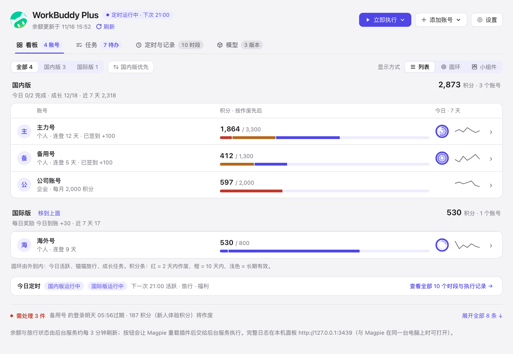
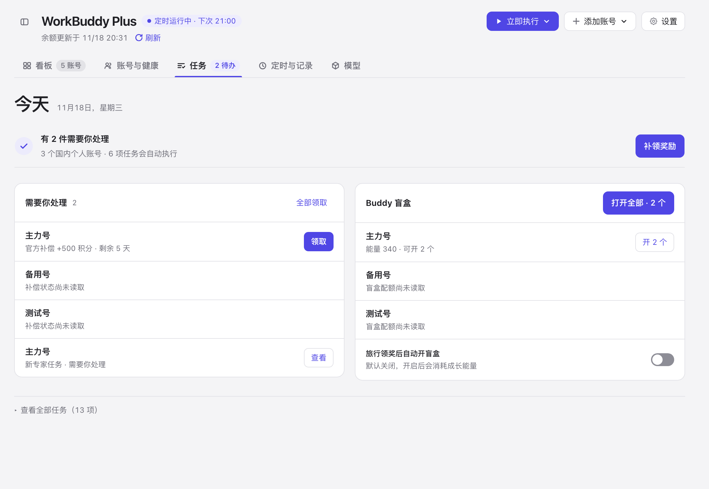
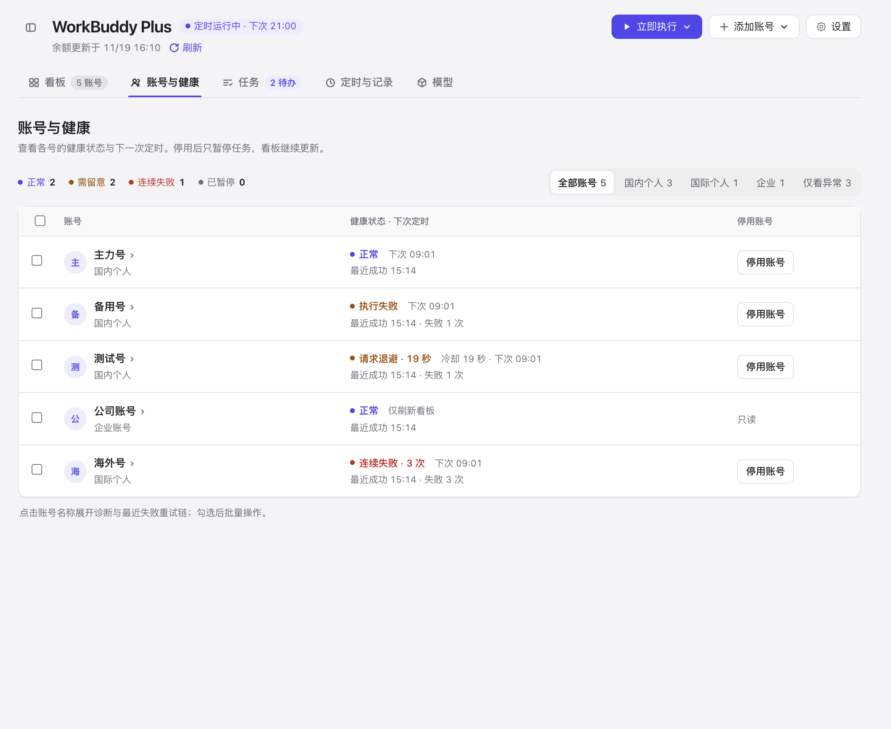
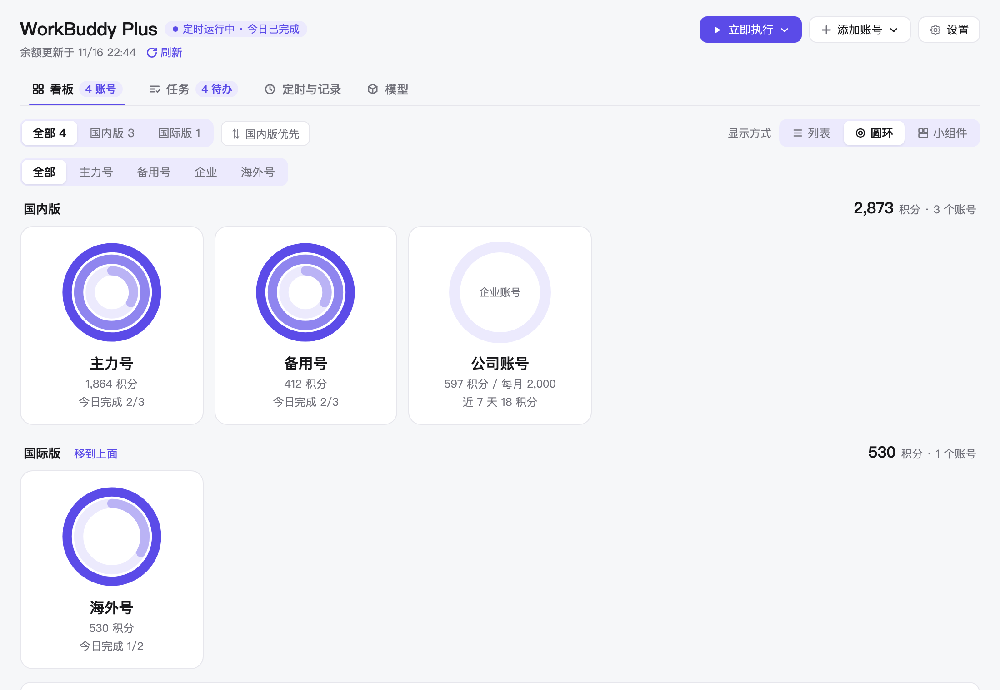
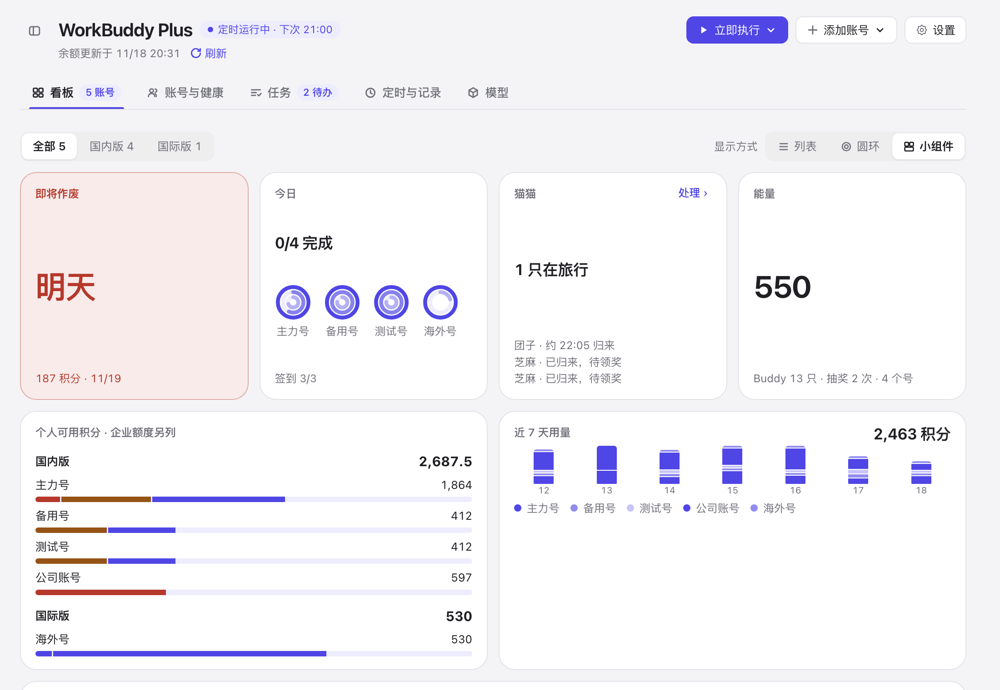
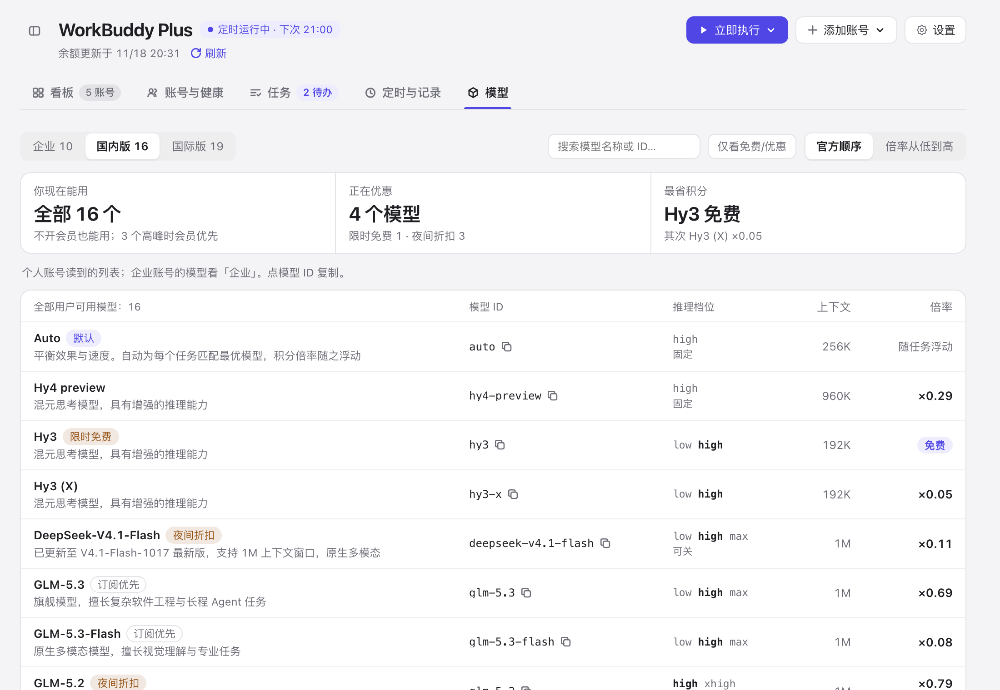
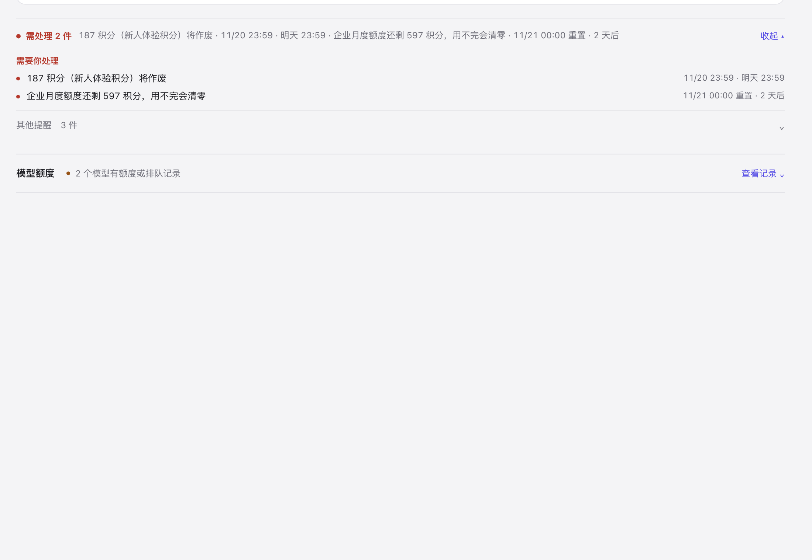
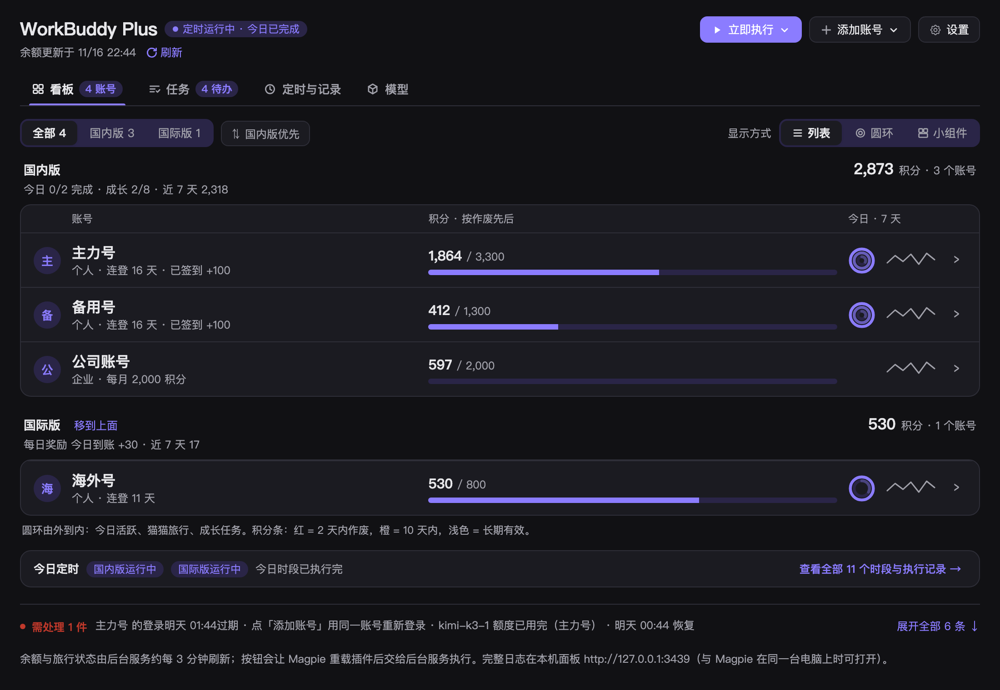
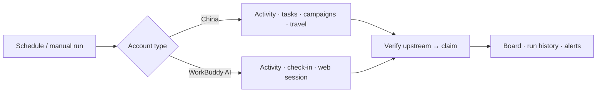
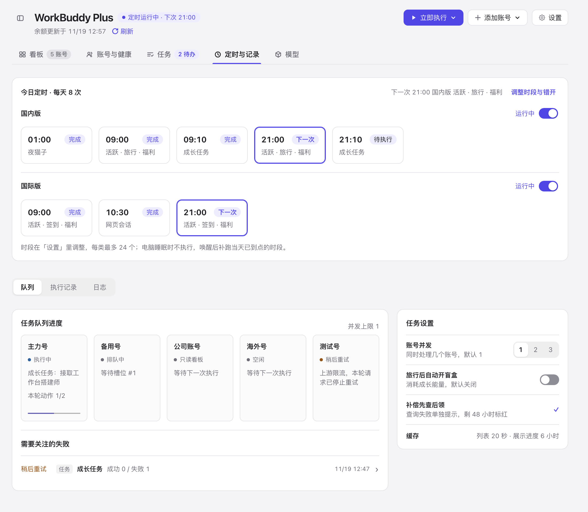

<div align="center">

# WorkBuddy Plus

**A companion plugin for WorkBuddy in Magpie (China and WorkBuddy AI)**<br>
Growth tasks, Buddy travel, login-streak rewards and schedules, plus one board that shows every account at a glance.

[](https://github.com/sabercomo/magpie-workbuddy-plus/actions/workflows/test.yml)
[](LICENSE)

[简体中文](README.md) · **English**

If you find it useful, a ⭐ Star helps others find it too.



</div>

> [!NOTE]
> An unofficial project for WorkBuddy China (the `workbuddy` accounts in Magpie) and WorkBuddy AI, the international build (`workbuddy-ai`). Sign-in, models and API forwarding stay with Magpie's WorkBuddy plugin. **China's daily check-in stays with Magpie** and this plugin never calls China's check-in; Magpie doesn't check in on WorkBuddy AI, so this plugin does, whenever WorkBuddy AI runs a check-in campaign.
>
> The plugin's page and messages are in Chinese. This README gives the Chinese names of buttons and views in quotes so you can find them.

## At a glance

| | |
| --- | --- |
| **Works once installed** | One `magpie plugin add` command. Magpie starts the background service when it launches, and a "WorkBuddy Plus" page appears in its sidebar. |
| **Runs the tasks for you** | Login-streak activity, growth and campaign tasks, claim-only sweeps, Buddy travel (send out and claim), streak rewards and the night-owl task, on a schedule, retried on failure. |
| **Account board** | Each account's credits, when each credit package lapses, the last 7 days of usage, and travel and task progress, in switchable views; the nav is horizontal by default and the fixed button to the left of the title switches to a sidebar and remembers the choice. |
| **Which models you can use** | The Models view (「模型」) lists both builds' models (and an enterprise's, when an enterprise account is added) with their ids, native reasoning levels, context and credit multipliers, sets WorkBuddy AI's Pro-only models apart, and marks subscriber priority and running promotions. |
| **WorkBuddy AI too** | With a WorkBuddy AI login in Magpie, that account is kept active daily, its streak tiers are redeemed, and it checks in whenever a campaign runs. It has its own schedule switch and times, apart from China's. |
| **What needs you** | Credits about to lapse, enterprise allowance resets and logins about to expire, gathered at the bottom of the board; exhausted or queued models get their own model-quota card. |
| **Add accounts** | A button opens WorkBuddy's official browser sign-in; this plugin never handles a token. |

## Screenshots

The plugin's page in Magpie's light and dark theme; every account and figure is made-up demo data (`sh docs/screenshots.sh` retakes them).

<table>
  <tr>
    <td width="50%"><br><sub><b>Main page · List</b>: China and WorkBuddy AI groups with credits, today's rings and the 7-day trend; open an account for its full detail</sub></td>
    <td width="50%"><br><sub><b>Tasks</b>: growth tasks and progress by account in natural-height columns, with travel + Buddy blind boxes and compensation + campaigns in two rows below; account cards and extras drag to reorder</sub></td>
  </tr>
  <tr>
    <td colspan="2"><br><sub><b>Accounts & health</b>: filter all, China personal, WorkBuddy AI personal, enterprise or abnormal accounts; expand for failure diagnostics, with three equal-width batch actions when selected</sub></td>
  </tr>
  <tr>
    <td width="50%"><br><sub><b>Rings</b>: each account's activity, travel and task rings; open one for its credit lapse timeline and usage</sub></td>
    <td width="50%"><br><sub><b>Widgets</b>: one fact per tile, summed across accounts</sub></td>
  </tr>
  <tr>
    <td width="50%"><br><sub><b>Models · China</b>: each model's id, native reasoning levels, context and multiplier, with subscriber priority, limited-time free and night discounts marked</sub></td>
    <td width="50%"><br><sub><b>Models · WorkBuddy AI</b>: what a Free account can use first, Pro-only models dimmed below</sub></td>
  </tr>
  <tr>
    <td width="50%"><br><sub><b>Models · Enterprise</b>: shown once an enterprise account is added, with the models its enterprise allows</sub></td>
    <td width="50%"><br><sub><b>Alert footer</b>: spent or queued models, expired logins, lapsing credits and network pauses grouped by reason; other reminders stay folded</sub></td>
  </tr>
  <tr>
    <td colspan="2"><br><sub><b>Dark mode</b>: follows Magpie's theme</sub></td>
  </tr>
</table>

## Install

First install Magpie's official WorkBuddy plugin, sign in to your China accounts and turn on the daily check-in. You never give this project a password.

Search for this project under Magpie's Plugins → Discover → Unofficial (「插件 → 发现 → 非官方」), or install it directly:

```sh
magpie plugin add github:sabercomo/magpie-workbuddy-plus
```

Then open "WorkBuddy Plus" in Magpie's sidebar (or **http://127.0.0.1:3439**), check the account list and turn on the switches at the right of the 「国内版」 (China) and 「国际版」 (WorkBuddy AI) rows in 「今日定时」 (dark green is running, gray is paused). **Both are paused after a fresh install**; manual runs work either way.

Whenever Magpie starts or reloads plugins, the plugin checks for the local service and starts it from the plugin folder if it isn't running. The service runs on its own: page buttons that make Magpie reload the plugin, and plugin updates, don't interrupt a running job, and it keeps running after you quit Magpie until you log out or shut down. To start it at login, turn on Magpie's login launch (`magpie autostart on`) or use the background install below.

<details>
<summary><b>Optional: run at login on macOS, without Magpie open</b></summary>

Needs Git and Bun 1.3+, with `magpie` and `bun` available in the terminal.

```sh
git clone https://github.com/sabercomo/magpie-workbuddy-plus.git
cd magpie-workbuddy-plus
bun install.mjs
```

The installer copies the runtime files to `~/Applications/Magpie-WorkBuddy-Plus`, registers the Magpie plugin and creates a macOS LaunchAgent that starts at login; any other LaunchAgent for the same folder is unloaded and renamed `.replaced`. You can delete the source folder afterwards.

Only one service holds the port at a time: when the LaunchAgent and Magpie both start one, the later one waits and takes over when the first exits, so nothing runs twice. The service pauses while the computer sleeps and, once awake and online, catches up on the day's slots that came due; the night-owl task only runs inside its night window. Nothing runs while the computer is off.

</details>

<details>
<summary><b>Windows and other platforms</b></summary>

On Windows and Linux, install with `magpie plugin add` too and let Magpie start the service; `bun install.mjs` above is macOS-only and exits with an error elsewhere. Verified on Windows 10 through Magpie; Linux is not yet verified.

Windows reserves some port ranges (for Hyper-V, WSL and others), and the default port 3439 may fall inside one or be taken by another program, including Windows' own HTTP service. The service then doesn't start and writes the reason to `%USERPROFILE%\.config\workbuddy-plus\service.log`. List the reserved ranges with `netsh interface ipv4 show excludedportrange protocol=tcp` and pick a port outside them (see Port under Settings and data).

To run without Magpie, install Bun, sign in to your China accounts and run this in the source folder:

```sh
bun server.mjs
```

Keep it running and start the schedules in the panel. Starting it at boot is up to your system's service manager; that part isn't verified across platforms yet.

</details>

## Features

The plugin does three things: **run tasks on schedule**, **explain every account**, and **collect what needs you at the bottom**.



| Layer | What you see / get |
| --- | --- |
| **Automatic tasks** | China runs activity, growth tasks, campaigns, claim-only sweeps, Buddy travel and streak rewards; official compensation is queried before claiming; new expert tasks are recognised from their `jump_url`. WorkBuddy AI runs activity, check-in and the web session. Each side keeps its own schedule and retries failures. |
| **What to do first** | The Tasks view lists growth tasks and progress by account in natural-height columns, with automatic tasks ready to run; short cards keep their own height. Below it, four cards handle travel, Buddy blind boxes, official compensation and campaigns account by account. Account cards and the four extras drag to reorder, remembered on this machine. |
| **Board, tasks and account health** | The board has five read-only views refreshed every 3 minutes. The Tasks page lists growth tasks by account in natural-height columns (short cards do not stretch), with filters and account/status grouping; account cards and the four extra cards drag to reorder (Alt+arrows too), remembered on this machine, and handle travel, Buddy blind boxes, official compensation and campaigns account by account. Accounts & health filters by account type or abnormal status and shows health, next schedule, pause controls and failure retry chains. Check-in, growth and travel stay on the board, and exhausted or queued models get a model-quota card at the foot of the board. |
| **Entry points** | Magpie sidebar, local panel `127.0.0.1:3439`, CLI and MCP; settings split into Schedule, WorkBuddy AI, Tasks, and Network & time zone. |
| **Guardrails** | Three days of format failures pause reporting; three network errors pause for 10 minutes; post-sleep catch-up and restart dedupe. Manual runs always work. |

To see the UI, jump to [Screenshots](#screenshots); for exact times see [Default schedule](#default-schedule).

<details>
<summary><b>Expand: full automatic-task rules</b></summary>

**Automatic tasks**

- Login-streak activity and reward checks in the China growth center.
- Growth tasks: accept, report events, check progress and claim; a task not reached is never recorded as claimed. Sharing a skill creates a real share channel and reports the link-copy actions; the same account reuses that channel for the rest of the day, so retries do not create duplicate links. Turn 「自动分享技能给好友」 off under 「设置 › 任务与对话」 to keep bulk runs from creating share links; the task center can still run that one task on demand. Mini-program tasks cover `Sequential_Tasks_1` to `7` (chats, an expert, GLM5.2, creating a scheduled task, ten chats and the PC playbook task); chat-style tasks go at a person's pace, about 45 seconds apart, because a burst is rolled back.
- Campaigns: it reads each China account's progress in the Starbucks, Reporter's Day and similar campaigns, performs the chat, expert, skill and desktop actions that can be reported as those clients, and claims rewards already earned. The App task creates a real cloud App conversation and waits for one completed turn before claiming; inviting friends still needs you. Because that conversation calls a model and may spend credits, 「自动完成活动 App 对话」 under 「设置 › 任务与对话」 is off by default: scheduled runs and 「执行所有任务」 skip only that item, the task center marks it 「设置已关闭」, and the campaign's other tasks still run. Only completed tasks are claimed, and once a campaign ends it is skipped.
- Claim-only sweep: runs apart from the growth-task round, accepts pending tasks and claims reached growth-task and campaign rewards without sending any behavior event. It can also be run by hand with 「补领奖励」 under 「立即执行」. Tasks you complete yourself, such as following the official WeChat account, are claimed automatically on the next growth-task round or sweep once upstream confirms completion, without signing into each account. The follow task requires 24 hours of following, as confirmed by server progress.
- Failure pause: a task whose `/v2/report` is rejected for its format (HTTP 400) on three days in a row is paused for scheduled runs; three consecutive network/proxy errors such as `ECONNRESET`, timeouts or refused connections pause automatic runs for 10 minutes. Manual runs always remain available and clear the pause on success.
- Buddy travel: send out and claim on return; handles `first_buddy` on first use.
- Streak make-up cards, 7/14/28-day streak exchanges, growth draws, starter packs and event compensation (status checked first). This streak is a different event from the daily check-in credits.
- Official compensation reads `compensation-status` first and claims only when the campaign is active, unclaimed and has credit. `active=false` and "already claimed" are not failures; a failed query is shown as a read failure.
- Open Buddy blind boxes with growth energy from the Tasks view. The “open a blind box after travel” setting is off by default. When enabled under Settings › Tasks & conversation, it opens boxes once while a Buddy is idle and eligible to depart. Manual and automatic opening check the travel status first and skip if a trip is underway, a reward is waiting, or the status is unclear. An account confirmed to have no Buddy can still open its first box.
- Growth draws record prize names in the existing execution log. A physical prize or address-required flag adds a reminder at the bottom of the Board. It asks you to enter shipping details in the Growth Center and opens the matching execution record. The reminder remains available across days while that record is retained. The response fields still need live-account verification.
- New expert tasks take their real `expertId` from their own `jump_url` (`deeplink` or `expert_use_<slug>`); they run as expert tasks once recognised. Unrecognised ones stay in that account's task card in Tasks, marked manual.
- China's check-in still belongs to Magpie; this plugin only reads `checkin-activity-status` to verify it, and the later record wins when upstream is checked but Magpie's file isn't updated yet.
- **WorkBuddy AI (international)**, with its own schedule switch (on its row in 「今日定时」) and times: daily activity that lights the heatmap and builds the streak; the 14-day (+50 credits) and 28-day (+150) tiers redeemed automatically; and the daily check-in whenever WorkBuddy AI runs a campaign (Magpie checks in on China only; as of 2026-11 WorkBuddy AI answers 「签到活动未开启或已过期」, no campaign running, and the plugin starts claiming once one does). WorkBuddy AI's **daily activity reward** (a Bonus Pack of 30 or 50 credits) counts only a finished conversation on its web app, not the desktop activity report, so WorkBuddy AI has a web conversation slot of its own (10:31 by default) that does what workbuddy2api does: it opens a conversation through the workbuddy.ai web channel, asks for a one-word reply, waits for it to finish and ends it, once a day. The model is picked automatically from those free right now (such as Hy3 while it's free, which cost nothing when measured); with none free, or if the free one turns it down (its daily free allowance spent, say), DeepSeek-V4.1-Flash runs it instead (about 0.6 credits). A model can also be set in 「设置」. Turn off 「每天跑一次网页会话」 there (the streak carries on, without this reward), or clear the slot, to stop it. WorkBuddy's usage list usually shows one web conversation as two requests a few seconds apart. The reward does not land when the conversation ends: it has arrived the night after the active day (02:00 to 07:00 Beijing time). The board shows 「每日活跃奖励 今日到账 +30」 or 「今日未到账」 for WorkBuddy AI accounts, and the credit history names that grant 「每日活跃奖励」. WorkBuddy AI's growth tasks (its 「养虾」 levels) count real use of its client and can't be simulated, so the board and the reminders no longer list them; with no check-in campaign running, no check-in is shown; it has no Buddy travel, so none is asked for, logged or shown, and its board rings are just activity and growth tasks.
- The night-owl task runs inside its valid window in Beijing time, at most once per account per day.
- Retries, catch-up after sleep for the day's slots, and no double runs after a restart.

</details>

<details>
<summary><b>Expand: what each board view shows</b></summary>

**Account board** (read only; refreshes with the service every 3 minutes, and shows China accounts signed in or out in Magpie within half a minute; claims or spends nothing)

Each realm header totals personal credits only, keeping up to two decimal places. Shared enterprise allowances stay on their own account rows and are never added to personal balances. The model-quota footer is a single summary row; clicking anywhere on its header, including the title or “View records / Monitoring notes”, expands the details. No refusal records means no refusals have been observed, rather than every model having been probed.

- Credit history (「积分流水」) in account details lists each grant's time, amount, source, remaining credit and expiration over the last seven days, with totals by source and spending for the same period. It shows the package's grant reason when available, then checks for a matching execution log or Magpie check-in record. Rows that cannot be matched show 「来源未确认」 (source unconfirmed). Coverage of the grant-reason field still needs live-account verification.
- Deductions (「扣分明细」): in the detail's right column, beside the credit history, the week's 50 most recent requests that cost credit, one row each: when, how much (to two decimals), the model and the client that sent it. Ten show; the rest open under 「再显示」. Above them, how many requests were charged and how many were free; older requests count only in the totals. An enterprise's allowance is shared by the team and its request list holds only this login's requests, so for enterprise accounts this column lists the team's daily totals from the enterprise daily usage endpoint (they add up to the total), with this login's request detail folded underneath.
- Model limits (「模型限额」): besides credits, each model has its own 24-hour allowance on each account; once it's spent, the model is refused (HTTP 429, code 6004) until it resets, and a model short of capacity answers 429 too (code 6020) with a queue position. WorkBuddy doesn't say how much is left, and the board sends no probe. Only a real chat that is refused is recorded: 6004 keeps its reset time, 6020 its queue position and wait, and spent models show under 「近 7 天用量」 in the account's detail and in the yellow 「模型额度用完」 box at the bottom. China's plugin sends no chat request of its own, so China's accounts show no such records; WorkBuddy AI's web conversation records one only when it is actually refused.
- Model queues (「排队中」): when a model is short of capacity, WorkBuddy queues requests and answers HTTP 429 too (code 6020, with the queue position and estimated wait), **enterprise accounts included**, however much allowance they have. Tools like Magpie retry a few times and then report `exceeded retry limit, last status: 429`. The check above records the position and when the wait should be over, shows it in the account's detail and the same yellow box, and drops it once that time passes; a queued model is checked again at most hourly.
- An account's 「成长」 (energy, Buddies, the next streak tier and open tasks) starts folded; click 「任务 x/y ▾」 to open it.
- An account's 「活动」 lists the running campaigns, each task's progress and claim state; manual items such as inviting friends are listed in the Tasks tab only and no longer raise reminders.
- A package is counted grant by grant: every reward in 「国内运营裂变包」, for one, is its own grant with its own 20 days, so only the grants about to lapse turn red and count as lapsing, never the whole package.
- List (「列表」): a group each for China and WorkBuddy AI. A group's header gives its credits and accounts (separate wallets, never added together), and under it a line of what its accounts need today: today's progress, growth tasks and 7-day use for China, the daily reward and 7-day use for WorkBuddy AI. The lower group's header has 「移到上面」 (move up), which swaps the two and is remembered, the rings and widgets following. Personal logins come first and an enterprise login last inside a group. One row per account, folded until opened (credit bar coloured by each grant's own lapse date, today's rings, a 7-day trend); open a row for packages, usage, tasks and travel.
- Tasks (「任务」): growth tasks and progress for domestic personal accounts only, filterable by claimable / automatic / manual / locked and groupable by account or status. Account cards sit in natural-height columns and short cards keep their own height; account cards and the four extras each have a six-dot grip: drag or use Alt+arrows to reorder, remembered on this machine; status grouping still groups by status. Four cards sit below in two rows — travel + Buddy blind boxes, official compensation + campaigns — while each keeps its content height, so a short card does not stretch. Compensation can be claimed per account or in bulk, blind boxes opened per account or in bulk, travel sent and claimed with one action, and campaigns run or claimed by state. Enterprise and WorkBuddy AI accounts never enter this view.
- Rings (「圆环」): one account at a time with today's rings (activity, travel, tasks), a credit lapse timeline and usage.
- Widgets (「小组件」): one fact per tile across all accounts: next lapse, today, Buddies, energy, personal credits (a subtotal each for China and WorkBuddy AI, with enterprise allowances listed separately), 7-day usage, growth tasks.
- Models (「模型」): switch between China (「国内版」) and WorkBuddy AI (「国际版」); with an enterprise account added, an 「企业」 tab comes first with the models that account may use (set by its enterprise, not the personal list), and without one it isn't shown. Models the current plan can use come first; WorkBuddy AI's Pro-only models are dimmed below. Each row has the model id (click to copy), reasoning levels, context and multiplier. Reasoning levels are each model's native ones from WorkBuddy's config (such as `low high max`), the default in bold, 「可关」 when thinking can be switched off, 「固定」 when there is only one, 「—」 when none are listed; multipliers of 3 or more are orange, and limited-time free, night discounts and subscriber priority follow WorkBuddy's own labels. WorkBuddy AI needs a `workbuddy-ai` sign-in in Magpie.
- At the bottom, today's schedule (「今日定时」) shows each slot's result and the next run; below it, the alert footer groups spent models (with their reset time) and queued models (with the estimated wait), logins about to expire, failed reads, credits lapsing within 2 days and network/proxy pauses by reason. Everything else (credit lapsing within 10 days, enterprise allowance resets, check-in notes) stays folded under 「其他提醒」 until opened.
- Each personal account shows today's daily check-in: for China, Magpie's record (checked in +100, not yet, needs the WorkBuddy client…), with a switched-off or missed check-in in the alerts; for WorkBuddy AI, this plugin's own result, or 「暂无签到活动」 (no campaign) while none runs. Enterprise accounts have no daily check-in credits and show none. WorkBuddy AI accounts are tagged 「国际版」 in the list.
- Enterprise accounts show their monthly allowance, usage and reset time.

</details>

<details>
<summary><b>Expand: entry points and settings</b></summary>

**Entry points**

- Magpie's sidebar page: 「添加账号」 (add account, China or WorkBuddy AI) at the top right; 「刷新」 (refresh) beside the update time; five tabs across the top by default — Board (with the account count), Accounts, Tasks (a badge only for compensation requiring manual action, failed compensation reads or unsupported tasks), Schedule &amp; Logs and Models; the fixed button to the left of the title switches between top tabs and a left sidebar and remembers the choice. Drag the divider to resize the sidebar in wide windows. Narrow windows show an icon rail. The view switcher (List / Rings / Widgets) is on the same line as the realm filter; in the board's 「今日定时」, a China row and a WorkBuddy AI row, each with a switch that pauses or starts that build's schedule (it only stops schedules; manual runs still work); and 「立即执行」 (run now) beside the run history, with 「执行所有任务」 (everything), 「猫猫旅行」 (Buddy travel), 「成长任务」 (growth tasks) and 「补领奖励」 (claim only). 「设置」 at the top right opens a settings view of its own in four groups: 「定时」, each build's times and the random offset; 「国际版」, the web conversation's switch and model; 「任务」, whether skill sharing and travel-time blind-box opening run automatically; 「网络与时区」, the time zone, the default HTTP proxy and the WorkBuddy AI proxy (for setups such as Docker where the local panel can't be reached; leaving the default empty makes China go direct, and WorkBuddy AI follows it unless set to `direct` or its own address).
- The local panel at http://127.0.0.1:3439 (local access only, so not from outside when Magpie runs in Docker): the same board, plus running selected accounts, the last 100 runs, and editing schedules and both proxies.
- Add account (「添加账号」) offers China or WorkBuddy AI and runs Magpie's own `magpie plugin login workbuddy` or `magpie plugin login workbuddy-ai`, which opens the official browser sign-in; signing in to an account again replaces its old login. This plugin never touches login tokens and offers no account file import or export.

</details>

> [!IMPORTANT]
> Growth tasks include simulated client event reports; they don't mean the action was really done in the desktop client. Whether they count, pay out, or get an account restricted is up to WorkBuddy, and not every task can be completed. Following the official account and real donations need you and are no longer listed (nor counted in the task total); sharing a skill creates a real share channel and reports the link-copy actions, so it runs automatically; once a task is reached it is still claimed. Besides the ordinary tasks, three kinds are reported as another client would: the desktop client's (a desktop chat, entering a Buddy app, 企鹅教师助手), the web app's (reading the library's introduction) and the mini program's own (`Sequential_Tasks_1` to `7`: chats, an expert, GLM5.2, a scheduled task, ten chats and the PC playbook task). The mini program's tasks unlock one a day, each after the one before it is claimed, and its chats are reported at a person's pace (about 45 seconds apart, since a burst is rolled back). Their event shapes follow [workbuddy2api-panel](https://github.com/misakano7545/workbuddy2api-panel) and [WorkBuddy-Daily](https://github.com/L0NE-6/WorkBuddy-Daily).

## Default schedule

All times are `Asia/Shanghai` and can be changed in the panel; clearing a kind's times turns that kind off.

| Time | China | WorkBuddy AI |
| --- | --- | --- |
| 01:01 | Night-owl task | — |
| 09:01, 21:01 | Activity, Buddy travel, streak rewards | Activity, check-in, streak rewards |
| 09:11, 21:11 | Growth tasks | — |
| 10:01, 22:11 | Claim-only sweep | — |
| 10:31 | — | Web conversation (daily activity reward, once a day) |

Every default minute is 01, with ten minutes between the slots that need their own place, so scheduled work does not reach WorkBuddy on the hour. Each build's times are edited in 「设置」 and paused with the switch on its row in 「今日定时」. On upgrade to 0.7.2 a config still holding the old untouched defaults moves to these times; a custom schedule is kept as it is. WorkBuddy AI's growth-task slot is gone from 0.5.9 (its tasks count only real use of its client, and the slot never claimed anything); a saved one is ignored. Upgrading from 0.5.6 or earlier, WorkBuddy AI keeps the times it had, with a missing web conversation slot filled at 10:31; if 「国际版任务」 was off, its schedule stays paused. A saved config without sweep times gets the default 10:01 and 22:11.

Each slot runs at a random moment around its set time (±10 minutes by default, different every day and on every computer; the night-owl task stays inside 23:00–08:00), and a scheduled run waits a random 5–45 seconds between accounts, so not everyone reaches WorkBuddy on the hour. Change it with 「随机错开」 under the panel's settings; 0 turns it off. The board's 「今日定时」 shows when each slot runs today. Schedules are checked every 30 seconds. A failure is retried at least 15 minutes later, up to 3 tries per slot. When WorkBuddy rate-limits (HTTP 429) the run first waits and retries; a run still limited is marked "retry later" (「稍后重试」) rather than failed, and is retried on the same spacing. Each kind takes up to 24 times. Streak activity doesn't repeat once it succeeded that day; travel and task rewards are checked against WorkBuddy's state. China's daily check-in follows Magpie's own setting and is not one of this plugin's schedules; WorkBuddy AI's check-in runs in the activity, travel and streak-rewards slots. With "open a blind box after travel" on, opening runs after a trip's reward and before departure inside the travel slot; it adds no slot of its own.

## Tools and terminal

The plugin's card under Plugins → Installed shows its tool names and lets you copy Magpie's MCP address.

| Tool | Use |
| --- | --- |
| `status` | China accounts, runs and schedule settings |
| `run` | Start an action; `all` covers activity, growth tasks, travel and streak rewards |
| `schedules` | Show or switch schedules (`enabled` for China, `intlEnabled` for WorkBuddy AI); times are edited in the web panel |
| `board` | The account board: credits, package lapse dates, 7-day usage, travel and streak |

In the source or install folder you can also use the terminal:

```sh
bun cli.mjs status
bun cli.mjs run all
bun cli.mjs board
bun cli.mjs pause
bun cli.mjs resume
```

`run` also takes `activity`, `tasks`, `sweep`, `task`, `travel`, `buddy`, `bonus`, `compensation`, `night` and `inspect`. `buddy` reads the quota and opens the smaller of "affordable" and the single-open cap, spending growth energy; `compensation` checks the campaign status and claims only an active, unclaimed grant with credit. `task` also needs the task code (`{"actions":["task"],"accounts":["cn:…"],"task":"chat_5"}`) and runs just that task. Each returns a run id; check the result in the panel or with `status`.

<details>
<summary><b>How the Magpie page works</b></summary>

Magpie runs plugin pages in a sandbox with no network, so the page reads `page/data.js`, which the service writes (balances, usage and travel only, no credentials), and reloads it every 15 seconds; after a plugin update an open page loads the new version by itself. The page's buttons submit requests by saving them into the plugin's options, which makes Magpie reload the plugin once and hand the request to the service; each request runs once, and one older than 10 minutes is refused. The page says so when its data is more than 25 minutes old.

</details>

## Queue, run history and logs

The “定时与记录” page keeps Today's Schedule at the top. Below it, switch between Queue, Run History and Logs, with Task Settings on the right; narrow windows stack the panels. Account cards show running, queued, paused and finished states. Progress counts the actions completed in the current round.



- **Account concurrency**: `concurrency` accepts 1–3, default 1, across all jobs. Actions within each account remain sequential. Lowering the limit lets active accounts finish before applying the new limit.
- **Retries**: expand a record for actual request times, HTTP statuses and waits. Without `Retry-After`, HTTP 429 waits 5 seconds, then 20 seconds, for at most three requests. Scheduled retries wait at least 15 minutes, for at most three rounds. Manual Retry targets only failed accounts/actions. Stop also cancels queued work.
- **Log channels**: Task, Conversation and System, with a failure filter. Conversation logs contain outcomes, never prompts. Older records remain readable; missing historical retry details are never invented.
- **Cache**: `tasksCacheTtl` defaults to 20 seconds (0–120), isolated by account, site and client channel and invalidated after accepts, reports or claims. `progressCacheHours` defaults to 6 hours (0–24); only failed reads use this persisted display snapshot, marked with its timestamp and the read error. Execution never uses that snapshot. Set either to 0 to disable it.
- **Accounts & health**: switch between all accounts, China personal, WorkBuddy AI personal, enterprise, and abnormal accounts. Each filter shows a count, and each account name has its type underneath. The abnormal filter includes paused accounts. A full-width three-column table shows the account, health and next schedule, and pause controls; last success, consecutive failures and request cooldown sit under health. Expand an account for diagnostics, its recent failure retry chain and a direct failed-operation retry. Each account can pause or resume tasks. Selection raises exactly three equal-width actions in one row: Refresh balance, Pause account tasks and Clear selection. Check-in, growth and travel stay on the board, and Magpie still owns sign-in and renewal.

The Tasks page's compensation panel supports individual and bulk claims, always queries first, marks deadlines within 48 hours red and adds a footer reminder. Query failures remain separate from “no compensation.” “Run all” and the Buddy panel's “Open all” use primary buttons; the claim-only sweep stays secondary. When no boxes are available the header stays as a disabled “Open all” without a number and each row shows a disabled “Open blind box” and “no boxes to open”; when nothing is claimable the bulk and per-account claim buttons stay visible but disabled, while failed rows keep “Re-query”. The Buddy panel shows available boxes per account; manual opening spends energy. `buddyAuto` is off by default. When enabled, idle/returned trips open boxes, re-read travel state and then depart. China's read-only check-in comparison uses the newer same-day observation from upstream or Magpie; yesterday's or undated snapshots cannot count as today's check-in. Buddy check-in and growth-plan streaks are shown separately.

The compensation, blind-box, dynamic-expert and check-in protocols still **need live-account verification**. No verified fields for the check-in campaign's start/end dates are available yet; the UI shows its open/closed status and check-in streak without inventing a date range.

## Settings and data

| Location | Contents |
| --- | --- |
| `~/.config/workbuddy-plus/config.json` | China's schedule switch and times (`enabled`, `schedules`), WorkBuddy AI's (`intlEnabled`, `intlSchedules`), the random offset in minutes (`spread`), account switches (`disabledAccounts`), accounts whose tasks are paused (`pausedAccounts`; the board keeps updating), WorkBuddy AI's daily web conversation and its model (`intlWeb`, `intlWebModel`; `auto` picks a free one), automatic skill sharing (`skillShare`), the campaign App conversation (`campaignApp`, off by default), travel-time blind-box opening (`buddyAuto`, off by default) account concurrency (`concurrency`), task-list and display-progress cache (`tasksCacheTtl`, `progressCacheHours`) and HTTP proxy (`proxy` is the default; `intlProxy` is WorkBuddy AI's; empty follows the default, `direct` goes without one) |
| `~/.config/workbuddy-plus/state.json` | Run history, de-duplication state and paused tasks |
| `~/.config/workbuddy-plus/service.log` | Service log |
| `page/data.js` in the plugin folder | The board snapshot for Magpie's page, rewritten by the service |
| `~/Library/LaunchAgents/io.github.sabercomo.magpie-workbuddy-plus.plist` | macOS background start (optional install) |

When started by Magpie, the plugin reads `plugin-auth.json` from Magpie's active data directory, including portable and relocated installations. Standalone mode defaults to `~/.config/magpie`, honors `XDG_CONFIG_HOME`, and supports `WORKBUDDY_PLUS_MAGPIE_DIR` as an override; `WORKBUDDY_PLUS_DIR` sets this plugin's data folder. If Add account still cannot find Magpie on Windows, sign in from Magpie's Providers page or add the Magpie install folder to PATH and restart Magpie.

**Port**: the service listens on `127.0.0.1:3439`. When it runs from Magpie, change it with the plugin option:

```sh
magpie plugin options <plugin name> '{"port":4389}'
```

The plugin name is the one `magpie plugin list` shows. When you start the service without Magpie, use the `WORKBUDDY_PLUS_PORT` environment variable; the macOS background install reads it when you run `bun install.mjs`, so to change the port later, install again with the new value and keep the plugin option on the same port. A port taken by another program or reserved by the system doesn't make the service wait: it writes the reason and exits. Only when a WorkBuddy Plus is already running on that port does a new service wait to take over.

<details>
<summary><b>What the board reads</b></summary>

The board only reads `get-user-resource` (credit packages; `get-enterprise-user-usage` for an enterprise account's monthly allowance), `get-user-request-usage` (official usage: credits, requests and models, plus the time, credit, model and client of the 50 most recent charged requests as the deductions list; request contents are not kept), the growth center's tasks, energy, Buddy collection and blind-box quota (`buddy/quota`), draw count, travel and streak state, and the official compensation status (`compensation-status`). It claims nothing. It sends no probe; only WorkBuddy AI's daily web conversation is a real chat (see above), carrying none of your conversations. Enterprise accounts show only their allowance and usage. China's daily check-in result is read from Magpie's own `plugin-checkin.json` and its switch, and `checkin-activity-status` is read only to verify it; this plugin never calls China's check-in endpoint. For WorkBuddy AI it reads `checkin-activity-status` and calls `daily-checkin` when a campaign runs and today isn't claimed yet.

The Models view reads both builds' `/v3/config` (the WorkBuddy client's own model config: models, multipliers, the Pro Only and subscriber-priority tiers, promotions) and `get-user-resource-summary` (the account's plan). It calls no model and spends no credits. The China list is read with the first personal account, the enterprise list with the first enterprise account, the WorkBuddy AI list only with the `workbuddy-ai` account signed in to Magpie.

The plugin reads the sign-ins saved by Magpie. Magpie handles sign-in and renewal. Keep the Magpie gateway running when you rely on scheduled tasks. The upgrade removes the old renewal times for both builds and preserves other schedule times. A change in Magpie's storage format may need an update here. Released source contains no personal account files, settings or run history.

The service listens on `127.0.0.1` only. A default HTTP proxy and a WorkBuddy AI proxy can be set in the panel; proxied requests need Bun. Node.js 22+ can run the tests, or the service without a proxy. The default proxy serves China and left empty means China goes direct; WorkBuddy AI follows it when its own field is empty, `direct` means no proxy for WorkBuddy AI, and an address applies to WorkBuddy AI only. If it reports 「代理 … 连不上，检查代理设置或清空代理」 (the proxy cannot be reached), check that the address and port are listening; if a direct connection works, clear that proxy, save and refresh. If the proxy reports `503 Service Unavailable`, check whether it can reach the WorkBuddy hostname in the error. In Docker or on a NAS, the proxy must be reachable from the environment running Magpie. The service launched by Magpie or the macOS installer ignores inherited `HTTP_PROXY`, `HTTPS_PROXY` and `ALL_PROXY`. When starting `server.mjs` manually on Bun older than 1.4.3, unset those variables, including lowercase variants, before launch.

</details>

## Updating and stopping

v0.8.0 fixes proxy credentials appearing in local status and configuration responses. The panel, Magpie tools, and CLI now show masked proxy addresses. The background service merges changed settings into the latest configuration, preserving settings saved elsewhere and stored proxy credentials. You can still replace a proxy, leave the international proxy blank to inherit the default, or set it to `direct`.

Click anywhere on the board's reminder summary to expand or collapse it, just like the model quota summary. The board keeps reminders expanded when it refreshes.

Installed from Magpie: run `magpie plugin update`. If you installed a pinned version (`magpie plugin list` shows a suffix like `#v0.4.0`), remove it with `magpie plugin rm` and `magpie plugin add` the unpinned address again; plugin options such as the port need setting again. From 0.5.5 on, when Magpie loads the updated plugin it finds the older service, asks it to exit and starts the new version, so no restart is needed (with a job running it waits for it, asking again each minute). Coming from 0.5.4 or earlier, the old service doesn't know that request yet: end it one last time (or log out, restart, or restart the container).

The macOS background install: update the source folder and install again; settings and history are kept.

```sh
git pull --ff-only
bun install.mjs
```

Turning the plugin off in Magpie only turns off its tools. **To stop automatic tasks, switch off both the China and the WorkBuddy AI rows in 「今日定时」 first**, or run `bun cli.mjs pause` (pauses both).

<details>
<summary><b>Removing the macOS background install completely</b></summary>

```sh
launchctl bootout "gui/$(id -u)" "$HOME/Library/LaunchAgents/io.github.sabercomo.magpie-workbuddy-plus.plist"
magpie plugin rm "$HOME/Applications/Magpie-WorkBuddy-Plus"
```

Then delete the install folder and the plist above. Settings and history in `~/.config/workbuddy-plus` can stay. If you also installed the plugin by its repository address, remove that entry from Magpie's installed list too.

</details>

## Development

No npm dependencies to install. Tests use mock accounts and a mock upstream, and never touch a personal account or a real reward endpoint.

```sh
npm test
```

The tests cover China and WorkBuddy AI account selection, official compensation queried before claiming (no campaign/already claimed never claim, a failed query stays an error), blind-box quota and the single-open cap, travel-time blind-box opening off by default, the per-account task list, filters/grouping, account and card reordering, zero-state disabled buttons without a “0” count, travel/campaign cards and compensation/Blind-box panels on the Tasks page, personal-versus-enterprise credit separation, manual todo counts, pill-switch persistence, the three-column Accounts & health table, WorkBuddy AI personal and enterprise filters, diagnostic retry chains and three equal-width batch actions, dynamic expert `jump_url` parsing, the later of upstream and Magpie check-in records, each build's own schedule switch and times (with settings from older versions), the claim-only sweep (accepting pending tasks, claiming reached growth-task and campaign rewards, and sending no behavior event), the task center's cross-account scan and single-task run, the event shapes and claims of mini-program `Sequential_Tasks_4` to `7`, the campaign App cloud conversation and rejection of an untrusted boxUrl, the web conversation's model choice and fallback, WorkBuddy AI tasks and check-in, credentials kept out of status replies, run-all never calling the daily check-in, growth task progress, travel rewards, package merging and lapse dates, task categories, usage paging and deductions, campaign task reads, execution and claims (only what is ready, 12304 is not a failure), the campaign App conversation off by default and the explicit opt-in, campaign status on the board and manual-item alerts, the minute-01 schedule defaults with custom times left alone, skill-share channels and their daily reuse, the automatic-share switch and single-task override, the three-day format-failure pause and its manual release, network failures stopping a round, consecutive network failures pausing scheduled runs until a manual success, the daily pause after an upstream restriction, model limits and queues (reset parsing, queue detection and display from real 429s), the service handoff after an update, settings saved from Magpie's page, WorkBuddy AI's web conversation and daily reward, board snapshots without credentials, page request de-duplication, rate-limit retries, the add-account flow, read-only sign-ins and migration of old renewal slots, schedule de-duplication, the panel and the local HTTP boundary, the model catalog, and the service port.

The README screenshots come from `sh docs/screenshots.sh`: `docs/demo-data.mjs` writes made-up accounts and headless Chrome renders the page in Magpie's theme.

The repository carries the `magpie-plugin` GitHub topic so Magpie's unofficial Discover section can find it; that doesn't mean Magpie's maintainers reviewed or recommend it.

## License and credits

MIT. Credit package merging and usage paging are adapted from [zseeu1/wbkit](https://github.com/zseeu1/wbkit) (MIT); reading the enterprise allowance follows Magpie's WorkBuddy plugin. Task and campaign work also references:

- [ardeyouxipianyi/workbuddy2api-hub](https://github.com/ardeyouxipianyi/workbuddy2api-hub): growth-task codes and event shapes, travel/streak, check-in results and skill-share channels; the community fork's Buddy blind boxes, expert-task `jump_url` resolution and the later-of-two check-in rule.
- [jichie/magpie-workbuddy-tasks](https://github.com/jichie/magpie-workbuddy-tasks): the Buddy blind-box quota/open flow and its default-off schedule.
- [misakano7545/workbuddy2api-panel](https://github.com/misakano7545/workbuddy2api-panel): desktop, web and mini-program report channels, the task center, claim-only sweep, and campaign and skill-share flows; official compensation status semantics from [linguo2625469/workbuddy2api-panel](https://github.com/linguo2625469/workbuddy2api-panel).
- [L0NE-6/WorkBuddy-Daily](https://github.com/L0NE-6/WorkBuddy-Daily): the event shapes for `Sequential_Tasks_4` to `7`, and the App campaign conversation flow.

Exact revisions, files and licenses are in [THIRD_PARTY_NOTICES.md](THIRD_PARTY_NOTICES.md).
